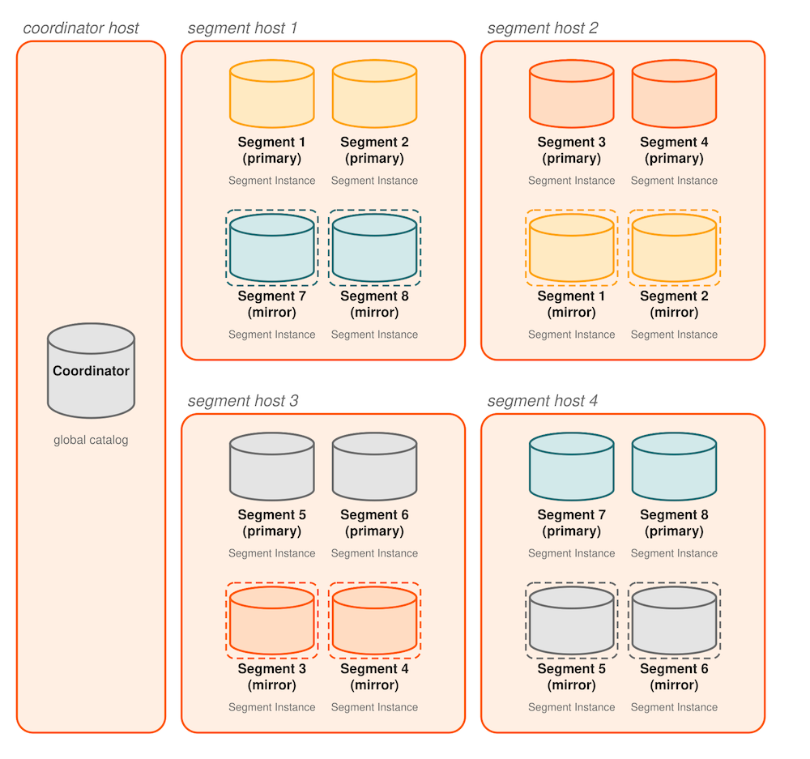
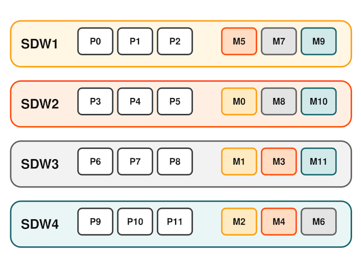
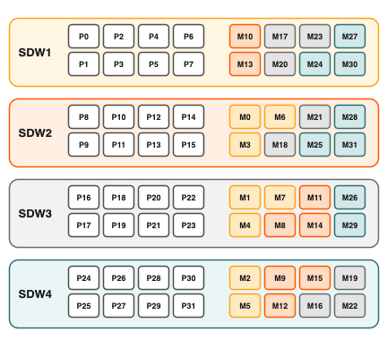

为了保证所需的服务级别，每个组件都必须有一个备用组件，在发生故障时随时接替。

## 磁盘存储 {#disk-storage}

在 Apache Cloudberry 的无共享 MPP 架构中，Coordinator 主机和 Segment 主机分别拥有自己的专用内存和磁盘存储，每个 Coordinator 或 Segment 实例都有独立的数据目录。为了兼顾可靠性和高性能，建议使用包含 8 到 24 块磁盘的硬件 RAID 存储方案。使用 RAID 5（或 RAID 6）时，磁盘数量越多，条带化带来的并行磁盘 I/O 就越高，I/O 吞吐量也越大。即使一块磁盘发生故障，RAID 控制器也可以继续工作，因为它会将奇偶校验数据保存在每块磁盘上，从而能够重建阵列中任意故障成员的数据。如果配置了热备盘（或操作员用新磁盘替换了故障磁盘），控制器会自动重建故障磁盘。

RAID 1 会对磁盘进行完全镜像，因此如果一块磁盘发生故障，可以立即使用性能与故障前相当的替代磁盘。RAID 5 中，故障阵列成员上的数据在替代磁盘重建完成前，每次 I/O 都必须根据剩余活动磁盘上的数据重建，因此会暂时降低性能。如果 Cloudberry Coordinator 和 Segment 都配置了镜像，则可以在重建期间将受影响的 Cloudberry 实例切换到镜像，以保持可接受的性能。

RAID 磁盘阵列仍可能成为单点故障，例如整个 RAID 卷发生故障。在硬件层面，如果支持，可以使用主机操作系统镜像或 RAID 控制器镜像对阵列进行镜像，以防范磁盘阵列故障。

定期监控每个 Segment 主机上的可用磁盘空间非常重要。查询 `gptoolkit` 模式中的 `gp_disk_free` 外部表，查看 Segment 上的可用磁盘空间。此视图会运行 Linux `df` 命令。在执行复制大型表等消耗大量磁盘空间的操作前，务必检查磁盘空间是否充足。

### 最佳实践 {#best-practices}

- 使用包含 8 到 24 块磁盘的硬件 RAID 存储方案。
- 使用 RAID 1、5 或 6，使磁盘阵列能够容忍一块磁盘故障。
- 在磁盘阵列中配置热备盘，使检测到磁盘故障后能够自动开始重建。
- 通过镜像 RAID 卷，防止整个磁盘阵列故障以及重建期间性能下降。
- 定期监控磁盘使用情况，并在需要时增加空间。
- 监控 Segment 数据倾斜，确保数据均匀分布，并且各 Segment 均匀消耗存储空间。

## Coordinator 镜像 {#coordinator-mirroring}

Apache Cloudberry Coordinator 实例是客户端访问系统的单一入口。Coordinator 实例存储全局系统目录，即保存数据库实例元数据的一组系统表，但不存储用户数据。如果未配置镜像的 Coordinator 实例发生故障或无法访问，Cloudberry 实例实际上就会离线，因为系统入口已经丢失。因此，必须准备 Standby Coordinator，在主 Coordinator 故障时接管。

Coordinator 镜像使用两个进程：活动 Coordinator 主机上的发送进程和镜像主机上的接收进程，用于将镜像与 Coordinator 同步。Coordinator 系统目录应用变更时，活动 Coordinator 会将其预写式日志（WAL）流式传输到镜像，使 Coordinator 上应用的每个事务都在镜像上应用。

镜像是*温备*。如果主 Coordinator 发生故障，必须由管理员用户在备用主机上运行 `gpactivatestandby` 工具，使其开始接受客户端连接，才能切换到备用实例。客户端必须重新连接到新的 Coordinator，并且会丢失主 Coordinator 故障时尚未提交的工作。

### 最佳实践 {#best-practices-1}

- 设置 Standby Coordinator 实例（即*镜像*），在主 Coordinator 故障时接管。
- Standby Coordinator 可以与主 Coordinator 位于同一主机，也可以位于不同主机；但最佳实践是将其放在不同主机上，以防范主机故障。
- 规划故障发生时如何将客户端切换到新的 Coordinator 实例，例如更新 DNS 中的 Coordinator 地址。
- 设置监控，在主实例故障时通过系统监控应用或电子邮件发送通知。

## Segment 镜像 {#segment-mirroring}

Apache Cloudberry 的每个 Segment 实例在 Coordinator 实例协调下存储和管理一部分数据库数据。如果未配置镜像的 Segment 发生故障，数据库可能必须关闭并恢复，最近一次备份之后发生的事务也可能丢失。因此，Segment 镜像是高可用解决方案的必要组成部分。

Segment 镜像是主 Segment 的热备。Apache Cloudberry 会检测 Segment 是否可用，并自动激活镜像。正常运行期间，主 Segment 实例处于活动状态时，数据通过以下两种方式从主 Segment 复制到镜像：

- 事务提交日志会在事务提交前从主 Segment 复制到镜像。这确保激活镜像时，主 Segment 上最后一个成功提交的事务所做的变更已经存在于镜像中。镜像激活后，日志中的事务会应用到镜像中的表。

- 其次，Segment 镜像使用物理文件复制更新堆表。Cloudberry Server 将表数据以包含元组的固定大小块存储在磁盘上。为了优化磁盘 I/O，块会缓存在内存中，直到缓存填满、必须驱逐部分块以便为新更新的块腾出空间。块从缓存驱逐时，会写入磁盘并通过网络复制到镜像。由于缓存机制，镜像上的表更新可能落后于主实例。但由于事务日志也会复制，镜像仍与主实例保持一致。镜像被激活时，激活过程会使用事务提交日志中尚未应用的变更更新表。

当工作中的主 Segment 无法访问其镜像时，复制会停止，主 Segment 状态变为“Change Tracking”。主 Segment 会将尚未复制到镜像的变更保存到系统表中，待镜像恢复联机后再复制到镜像。

Coordinator 会自动检测 Segment 故障并激活镜像。故障发生时正在进行的事务会使用新的主 Segment 重新启动。根据镜像在主机上的部署方式，原始主 Segment 恢复前，数据库系统可能处于不平衡状态。例如，如果每台 Segment 主机有四个主 Segment 和四个镜像 Segment，并且某台主机上的一个镜像被激活，那么该主机将有五个活动主 Segment。查询必须等到最后一个 Segment 完成工作后才算完成，因此在恢复原始主 Segment、恢复平衡前，性能可能会下降。

管理员可以在 Apache Cloudberry 运行期间运行 `gprecoverseg` 工具执行恢复。该工具定位故障 Segment，验证其有效性，并将事务状态与当前活动 Segment 进行比较，以确定 Segment 离线期间发生的变更。`gprecoverseg` 会将发生变化的数据库文件与活动 Segment 同步，并使该 Segment 恢复联机。

必须在 Segment 主机上预留足够的内存和 CPU 资源，以便故障期间接替主角色的镜像能够承担增加的活动量。

### 最佳实践 {#best-practices-2}

- 为所有 Segment 设置镜像。
- 将主 Segment 与其镜像放在不同主机上，以防范主机故障。
- 镜像可以位于单独的一组主机上，也可以与主 Segment 共置在同一组主机上。
- 设置监控，在主 Segment 故障时通过系统监控应用或电子邮件发送通知。
- 使用 `gprecoverseg` 工具及时恢复故障 Segment，恢复冗余并使系统重新达到最佳平衡。

## 双集群 {#dual-clusters}

对于某些使用场景，可以维护两个存储相同数据的 Apache Cloudberry 集群，以提供额外的冗余级别。是否实施双集群，应根据业务需求决定。

双集群配置有两种推荐的数据同步方式。第一种称为双 ETL。ETL（提取、转换和加载）是数据仓库中常见的流程，用于清理、转换、验证数据并将其加载到数据仓库中。使用双 ETL 时，ETL 流程在两个集群上各执行一次，两次执行并行进行，并分别验证结果。双 ETL 提供一个包含相同数据的完整备用集群，还可以查询两个集群上的数据，使处理吞吐量翻倍。应用可以按需使用两个集群，同时确保两边的 ETL 都成功并通过验证。

维护双集群的第二种机制是备份与恢复。数据先在主集群上备份，然后将备份复制到第二个集群并在其上恢复。备份与恢复机制的延迟高于双 ETL，但需要开发的应用逻辑较少。对于每天或更低频率执行数据修改和 ETL 的使用场景，备份与恢复很适合。

### 最佳实践 {#best-practices-3}

- 考虑使用双集群配置，提供额外的冗余级别和查询处理吞吐量。

## 备份与恢复 {#backup-and-restore}

除非数据库中的数据能够轻松、干净地从源数据重新生成，否则建议备份 Apache Cloudberry 数据库。备份可以防范运维、软件或硬件错误。

`gpbackup` 工具会在各个 Segment 上并行执行备份，因此备份能力可以随着集群硬件规模增长而扩展。

备份策略必须考虑备份写入的位置和存储的位置。可以将备份写入本地集群磁盘，但不应永久存储在那里。如果数据库和备份位于同一存储中，二者可能同时丢失。备份也会占用原本可用于数据库存储或操作的空间。执行本地备份后，应将文件复制到安全的集群外位置。

另一种方式是直接备份到 NFS 挂载。如果集群中每台主机都有 NFS 挂载，可以直接将备份写入 NFS 存储。建议使用横向扩展 NFS 方案，确保备份不会受 NFS 设备 I/O 吞吐量限制。Dell EMC Isilon 就是这类方案的一个示例，并且可以随 Cloudberry 集群扩展。

最后，通过原生 API 集成，Apache Cloudberry 可以将备份直接流式传输到 Dell EMC Data Domain 企业备份平台。

### 最佳实践 {#best-practices-4}

- 定期备份 Apache Cloudberry，除非数据可以轻易从源重新恢复。

- 使用 `gpbackup` 命令指定需要备份的模式和表。更多信息请参见 [`gpbackup`](/cloudberry/sys-admin/backup-and-restore/) 参考。

- `gpbackup` 会对要备份的表集合加 `SHARED ACCESS` 锁。表数量较少的备份更适合有选择地恢复模式和表，因为 `gprestore` 不需要搜索整个数据库。

- 如果备份保存在本地集群存储中，备份完成后将文件移到安全的集群外位置。位于同一存储中的备份文件和数据库文件可能同时丢失。
- 如果备份保存在 NFS 挂载中，使用 Dell EMC Isilon 等横向扩展 NFS 方案，防止 I/O 瓶颈。

- Cloudberry 用户应考虑将备份流式传输到 Dell EMC Data Domain 企业备份平台。

## 检测故障的 Coordinator 和 Segment 实例 {#detect-failed-coordinator-and-segment-instances}

即使系统能够检测故障并激活故障组件的备用实例，从系统故障中恢复仍需要系统管理员介入。每种情况下都必须替换或恢复故障组件，才能恢复完整冗余。在故障组件恢复前，活动组件没有备用实例，系统可能无法以最佳状态运行。因此，及时执行恢复操作非常重要。持续监控系统可以确保管理员了解需要处理的故障。

Apache Cloudberry 服务器的 `ftsprobe` 子进程负责故障检测。`ftsprobe` 按照配置参数 `gp_fts_probe_interval` 指定的时间间隔连接并扫描所有 Segment 和数据库进程。如果 `ftsprobe` 无法连接某个 Segment，就会在 Apache Cloudberry 系统目录中将该 Segment 标记为“down”。在管理员运行 `gprecoverseg` 恢复工具前，该 Segment 会一直处于停机状态。

### 最佳实践 {#best-practices-5}

- 运行 `gpstate` 工具查看 Cloudberry 系统的整体状态。

### 其他信息 {#additional-information}

*Apache Cloudberry 管理员指南*：

- [监控 Cloudberry 系统](/cloudberry/sys-admin/check-database-system/)

*Apache Cloudberry 工具指南*：

- [gpstate](/cloudberry/reference/sys-utilities/gpstate/)——查看 Cloudberry 系统状态
- [gprecoverseg](/cloudberry/reference/sys-utilities/gprecoverseg/)——恢复故障 Segment
- [gpactivatestandby](/cloudberry/reference/sys-utilities/gpactivatestandby/)——将 Standby Coordinator 设为活动 Coordinator

[RDBMS MIB 规范](https://datatracker.ietf.org/doc/html/rfc1697)

## 配置 Segment 镜像 {#configure-segment-mirroring}

Segment 镜像允许数据库查询在主 Segment 故障或不可用时切换到备用 Segment。Cloudberry 要求受支持的生产 Apache Cloudberry 系统配置镜像。

主 Segment 及其镜像必须位于不同主机上，才能确保高可用。Apache Cloudberry 系统中的每台主机都拥有相同数量的主 Segment 和镜像 Segment。多宿主主机的每个接口上也应具有相同数量的主 Segment 和镜像 Segment。这样可以确保所有主 Segment 正常运行时，Segment 主机和网络资源获得均衡负载，并让查询处理能够使用最多资源。

Segment 变得不可用时，另一台主机上的镜像 Segment 会成为活动主 Segment，处理继续进行。主机上的额外负载会造成倾斜并降低性能，但应能让系统继续运行。数据库查询必须等到所有 Segment 返回结果后才算完成，因此，某台主机多出一个活动主 Segment 的效果与集群中每台主机都多出一个主 Segment 相同。

故障切换场景中，当没有任何主机拥有多个接替主角色的镜像时，性能下降最少。如果多个 Segment 或主机发生故障，性能下降程度取决于接替主角色的镜像数量最多的主机。将一台主机的镜像分散到其余主机上，可以在任意单台主机发生故障时将性能下降降至最低。

还必须考虑集群对多台主机同时故障的容忍度，以及添加主机扩容集群时如何维护镜像配置。不存在适用于所有情况的理想镜像配置。

可以让 Apache Cloudberry 使用两种标准配置之一，在集群主机上安排镜像；也可以自行设计镜像配置。

两种标准镜像布局是*组镜像*和*分散镜像*：

- **组镜像**——每台主机为另一台主机的主 Segment 设置镜像。这是 `gpinitsystem` 的默认配置。
- **分散镜像**——将镜像分散到可用主机上。这要求集群主机数大于每台主机上的 Segment 数量。

可以设计自定义镜像配置，并使用 Cloudberry `gpaddmirrors` 或 [`gpmovemirrors`](/cloudberry/reference/sys-utilities/gpmovemirrors/) 工具设置该配置。

*块镜像*是一种自定义镜像配置，将集群主机划分为大小相同的块，并将镜像均匀分布到块内主机上。如果一个主 Segment 发生故障，同一块中另一台主机上的镜像会成为活动主 Segment。如果一台 Segment 主机发生故障，该块中其余主机上的镜像 Segment 会被激活。

以下各节比较组镜像、分散镜像和块镜像配置。

### 配置组镜像 {#configure-group-mirroring}

组镜像最容易设置，也是 Cloudberry 的默认镜像配置。它的扩容成本最低，因为只需添加两台主机即可完成扩容。扩容后不需要移动镜像，就能保持一致的镜像配置。

下图展示了四台主机上包含八个主 Segment 的组镜像配置。



只要同一 Segment 实例的主实例和镜像不同时发生故障，最多一半主机发生故障时集群仍可继续运行，前提是剩余资源（CPU、内存和 I/O）足以满足需求。

任何主机发生故障都会使性能下降一半或更多，因为包含镜像的主机上的活动主 Segment 数量会翻倍。如果正常资源利用率高于 50%，必须调整工作负载，直到故障主机恢复或被替换。如果正常资源利用率低于 50%，则在故障修复前，集群可以继续以降低的性能运行。

### 配置分散镜像 {#configure-spread-mirroring}

使用分散镜像时，每台主机的主 Segment 镜像会分散到与每台主机上的 Segment 数量相同的主机数中。集群初始化时容易设置分散镜像，但要求集群主机数至少比每台主机上的 Segment 数量多一台。

下图展示了四台主机、每台三个主 Segment 的集群所采用的分散镜像配置。



采用分散镜像扩容集群需要更多规划，可能也需要更多时间。必须添加一组主机，其数量等于每台主机上的主 Segment 数量加一；或者，可以在组镜像配置中添加两个节点，扩容完成后再移动镜像，以重新创建分散镜像配置。

单台主机故障时，分散镜像对性能的影响最小，因为每台主机的镜像分散在最多数量的主机上。负载增加 1/*N*，其中 *N* 是每台主机上的主 Segment 数量。但是，当两台或更多主机同时故障时，分散镜像最有可能发生灾难性故障。

### 配置块镜像 {#configure-block-mirroring}

使用块镜像时，节点会划分成多个块，例如由四台或八台主机构成的块；每台主机上的 Segment 镜像会放置到块内的其他主机上。根据块中的主机数量和每台主机上的主 Segment 数量，每台主机会为块中其他每台主机的 Segment 维护多个镜像。

下图展示了一个块镜像配置：块由四台主机构成，每台主机有八个主 Segment。



如果有八台主机，则会添加另一个四主机块，并按照相同模式为主 Segment 32 到 63 设置镜像。

采用块镜像的集群易于扩容，因为每个块都是自包含的主镜像组。通过添加一个或多个块来扩展集群。扩容后不需要移动镜像，就能保持一致的镜像设置。只要发生故障的主机位于不同块中，该配置就能够承受多台主机故障。

由于块中的每台主机都为块内其他主机维护多个镜像实例，主机故障对块镜像性能的影响高于分散镜像，但低于组镜像。预计的性能影响取决于块大小和每个节点上的主 Segment 数量。与组镜像一样，只要资源充足，性能会受到负面影响，但集群仍保持可用。如果资源不足以承担增加的负载，必须减少工作负载，直到故障节点被替换。

### 实施块镜像 {#implement-block-mirroring}

块镜像不是 Apache Cloudberry 在设置或扩容集群时提供的自动选项之一。要使用块镜像，必须创建自己的配置。

对于新的 Cloudberry 系统，可以在不配置镜像的情况下初始化集群，然后使用自定义镜像配置文件运行 `gpaddmirrors -i mirror_config_file`，为每个块创建镜像。运行 `gpaddmirrors` 前，必须创建镜像 Segment 的文件系统位置。

如果要扩容已经使用块镜像的系统，或希望在扩容集群的同时实施块镜像，建议先使用默认的组镜像配置完成扩容，然后使用 `gpmovemirrors` 工具将镜像移动到块配置中。

要在采用其他镜像方案的现有系统中实施块镜像，必须先根据块配置确定每个镜像的目标位置，然后确定哪些现有镜像需要迁移。请执行以下步骤：

1. 运行以下查询，查找主 Segment 和镜像 Segment 的当前位置：

    ```sql
    SELECT dbid, content, role, port, hostname, datadir FROM gp_segment_configuration WHERE content > -1 ;
    ```

    `gp_segment_configuration` 系统目录表包含当前的 Segment 配置。

2. 创建一个列表，其中包含当前镜像位置和所需的块镜像位置，然后从列表中删除已经位于正确主机上的镜像。
3. 为 `gpmovemirrors` 工具创建输入文件，为每个必须移动的镜像添加一条记录。

    `gpmovemirrors` 输入文件的格式如下：

    ```text
    old_address|port|data_dir new_address|port|data_dir
    ```

    其中，`old_address` 是 Segment 主机的主机名或 IP 地址，port 是通信端口，`data_dir` 是 Segment 实例数据目录。

    以下示例 `gpmovemirrors` 输入文件指定要移动三个镜像 Segment。

    ```text
    sdw2|50001|/data2/mirror/gpseg1 sdw3|50001|/data/mirror/gpseg1
    sdw2|50001|/data2/mirror/gpseg2 sdw4|50001|/data/mirror/gpseg2
    sdw3|50001|/data2/mirror/gpseg3 sdw1|50001|/data/mirror/gpseg3
    ```

4. 运行类似以下命令的 `gpmovemirrors`：

    ```shell
    gpmovemirrors -i mirror_config_file
    ```

`gpmovemirrors` 工具会验证输入文件，调用 `gprecoverseg` 迁移每个指定的镜像，并删除原镜像。它会创建一个回退配置文件，可将该文件作为 `gpmovemirrors` 的输入来撤销所做的更改。回退文件的名称与输入文件相同，并附加后缀 `_backout_timestamp`。
