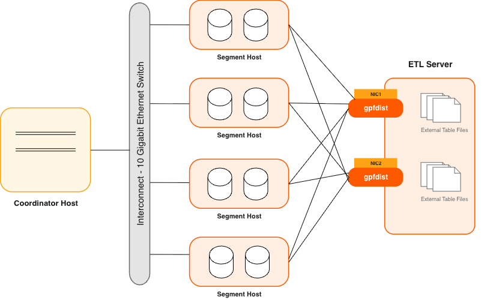

在规模达数 TB 的大型数据仓库中，必须在较短的维护窗口内加载大量数据。Cloudberry 通过外部表支持快速并行加载数据。管理员还可以采用单行错误隔离模式加载外部表，将错误行写入独立的错误日志，同时继续加载格式正确的行。管理员可以为加载操作指定错误阈值，以控制出现多少格式错误行时 Cloudberry 会取消加载操作。

将外部表与 Apache Cloudberry 的并行文件服务器（`gpfdist`）结合使用，管理员可以充分发挥 Apache Cloudberry 系统的并行能力和加载带宽。

另一个 Cloudberry 工具 `gpload` 可执行在 YAML 格式控制文件中指定的加载任务。在控制文件中描述源数据位置、格式、所需转换、参与的主机、目标数据库及其他细节后，`gpload` 就会执行加载。这样便能描述复杂任务，并以可控、可重复的方式执行。
