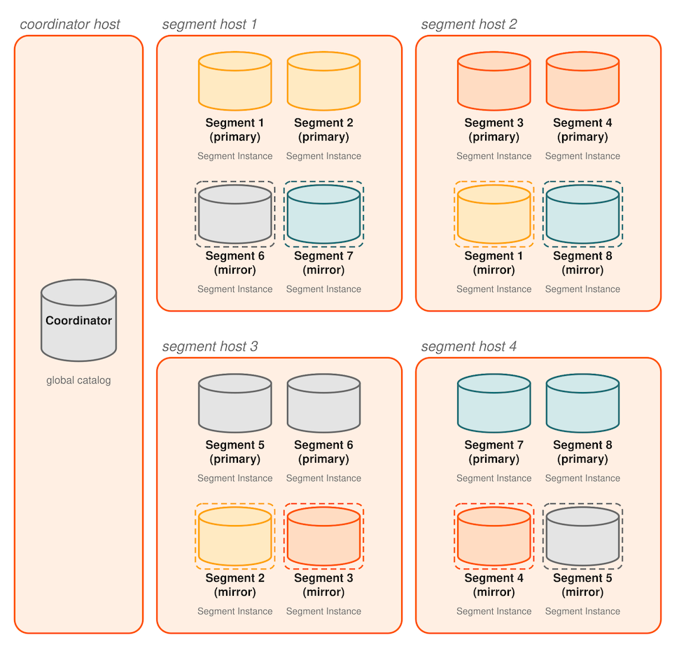
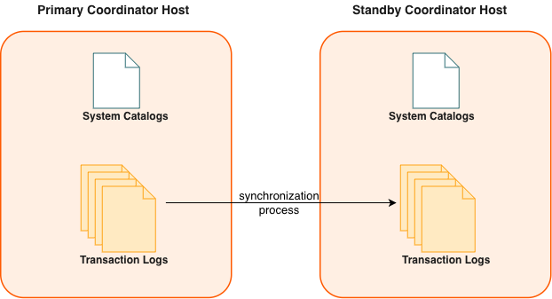

为各组件配置镜像，可以部署没有单点故障的 Apache Cloudberry 系统。以下各节介绍 Cloudberry 系统主要组件的镜像策略。

> **重要** 如果 Apache Cloudberry 集群不能接受数据丢失，建议启用 Coordinator 和 Segment 镜像。如果未启用镜像，Cloudberry 只存储一份数据副本；一旦发生硬件故障，数据的可用性与正确性就只能依赖底层存储介质来保障。

## Segment 镜像 {#about-segment-mirroring}

部署 Apache Cloudberry 系统时，可以配置*镜像* Segment 实例。主 Segment 不可用时，数据库查询可以切换到镜像 Segment。事务日志复制进程会同步主实例与镜像实例的数据，使镜像 Segment 保持最新。强烈建议生产系统启用镜像。

为防范单台主机故障，最佳实践要求备用（镜像）Segment 实例始终与主 Segment 实例位于不同的主机上。在虚拟化环境中，备用（镜像）Segment 必须始终与主 Segment 使用不同的存储系统。可以将镜像 Segment 分布在集群的其他主机上，通过合理配置来尽可能提高可用性，或减轻主机或多个主 Segment 故障时的性能下降。

初始化或扩容 Cloudberry 系统时，有两种标准镜像配置可供选择。默认配置称为*分组镜像*（group mirroring），将一台主机上所有主 Segment 的镜像放在集群中的另一台主机上。另一种标准配置称为*分散镜像*（spread mirroring），可以通过命令行选项选择。分散镜像将每台主机的镜像分布到其余主机上，要求集群主机数大于每台主机上的主 Segment 数量。

下图展示配置分散镜像时，表数据如何分布在各个 Segment 上。

## Segment 故障切换与恢复 {#segment-failover-and-recovery}

在 Apache Cloudberry 系统中启用 Segment 镜像后，如果*主 Segment* 实例不可用，系统会自动切换到*镜像 Segment* 实例。只要剩余活动 Segment 实例中包含全部数据，即使某个 Segment 实例或主机停机，Apache Cloudberry 系统也能继续运行。

如果 Coordinator 无法连接某个 Segment 实例，就会在 Apache Cloudberry 系统目录中将其标记为停机，并启动镜像 Segment 来替代它。发生故障的 Segment 实例会一直停用，直到管理员采取措施使其重新上线。管理员可以在系统正常运行时恢复故障 Segment。恢复过程只复制该 Segment 停用期间遗漏的变更。

如果没有启用镜像，当某个 Segment 实例失效时，系统会自动关闭。必须先恢复所有故障 Segment，才能继续运行。

## Coordinator 镜像 {#about-coordinator-mirroring}

也可以选择在不同于 Coordinator 主机的另一台主机上，部署 Coordinator 实例的备份或镜像。备用 Coordinator 实例（*Standby Coordinator*）在主 Coordinator 主机无法运行时充当*温备*。事务日志复制进程会同步主 Coordinator 与 Standby Coordinator 之间的数据，使 Standby Coordinator 保持最新。

主 Coordinator 故障时，日志复制进程会停止，此时可以激活 Standby Coordinator 来替代它。切换不会自动发生，必须由外部触发。激活 Standby Coordinator 后，系统利用已复制的日志，将 Coordinator 主机的状态重建到最后一次成功提交事务时的状态。激活后的 Standby Coordinator 实际上就成为 Apache Cloudberry 的 Coordinator，并在 Coordinator 端口上接受客户端连接；Coordinator 主机与备用 Coordinator 主机上的端口号必须相同。

由于 Coordinator 不包含用户数据，主副本与备用副本之间只需同步系统目录表。更新这些表时，变更会自动复制到 Standby Coordinator，确保其与主 Coordinator 同步。

## Interconnect 冗余 {#about-interconnect-redundancy}

*Interconnect* 指 Segment 之间的进程间通信，以及这种通信所依赖的网络基础设施。可以在网络中部署两台千兆以太网交换机，并为 Apache Cloudberry 主机服务器（Coordinator 与 Segment）配置冗余的千兆连接，从而实现 Interconnect 高可用。出于性能考虑，建议采用 10 Gb 或更高速率的以太网。
