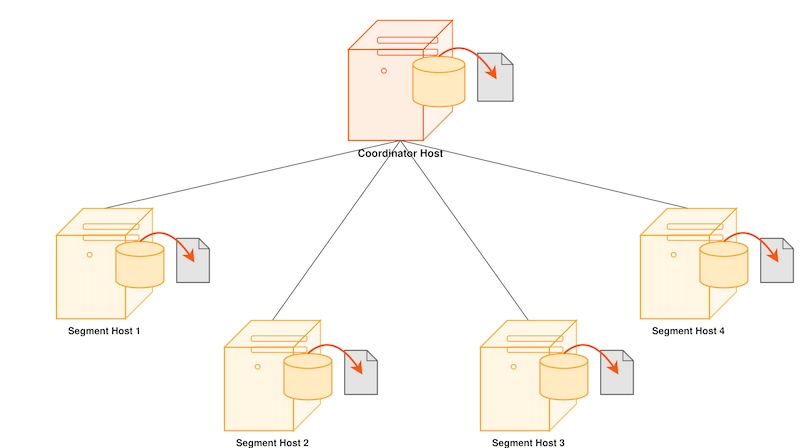
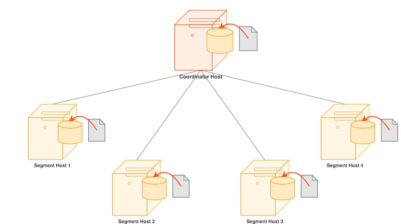

> [!NOTE]
> Apache Cloudberry 默认不包含 `gpbackup` 工具。该工具由独立项目维护。使用前请按照[README](https://github.com/apache/cloudberry-backup)安装 `gpbackup`。

并行转储工具 `gpbackup` 同时备份 Apache Cloudberry Coordinator 实例和每个活动的 Segment 实例。

默认情况下，gpbackup 会在 backups 子目录中创建转储文件。

Coordinator 会生成多个转储文件，其中包含 DDL 语句、Apache Cloudberry 系统目录表和元数据文件等数据库信息。gpbackup 会为每个 Segment 创建转储文件。

你可以执行完整备份或增量备份。要将数据库恢复到执行增量备份时的状态，恢复过程会先恢复之前的完整备份，再恢复其后的所有增量备份。



备份创建的每个文件都以一个 14 位时间戳键开头，用于标识该文件所属的备份集。

可以直接在 Coordinator 主机的终端中运行 gpbackup，也可以将其加入 Coordinator 主机的 crontab，以安排定期备份。

并行恢复工具 `gprestore` 接收 gpbackup 生成的时间戳键，验证备份集，并将数据库对象和数据并行恢复到分布式数据库中。并行恢复操作要求备份集完整，且该备份集由 gpbackup 创建的完整备份以及所有必需的增量备份组成。



gpbackup 工具提供了灵活性和验证选项，既可以处理 gpbackup 自动生成的备份文件，也可以处理从 Apache Cloudberry 集群移动到其他位置的备份文件。

## 练习 {#exercises}

本练习将引导你创建数据库的完整备份，然后恢复其中的一张表。

1. 要执行完整备份，请使用 `gpbackup --dbname database --backup-dir /path/for/backup`。这会将整个数据库备份到指定目录。

    ```bash
    [gpadmin@cdw tmp]$ gpbackup --dbname tutorial --backup-dir /tmp/
    ```

    ```
    20230727:10:28:19 gpbackup:gpadmin:cdw:020061-[INFO]:-gpbackup version = 1.2.7-beta1+dev.7
    20230727:10:28:19 gpbackup:gpadmin:cdw:020061-[INFO]:-Greenplum Database Version = oudberry Database 1.0.0 build dev
    20230727:10:28:19 gpbackup:gpadmin:cdw:020061-[INFO]:-Starting backup of database tutorial
    20230727:10:28:19 gpbackup:gpadmin:cdw:020061-[INFO]:-Backup Timestamp = 20230727102819
    20230727:10:28:19 gpbackup:gpadmin:cdw:020061-[INFO]:-Backup Database = tutorial
    20230727:10:28:19 gpbackup:gpadmin:cdw:020061-[INFO]:-Gathering table state information
    20230727:10:28:19 gpbackup:gpadmin:cdw:020061-[INFO]:-Acquiring ACCESS SHARE locks on tables
    Locks acquired:  28 / 28 [==============================================================] 100.00% 0s
    20230727:10:28:19 gpbackup:gpadmin:cdw:020061-[INFO]:-Gathering additional table metadata
    20230727:10:28:20 gpbackup:gpadmin:cdw:020061-[INFO]:-Getting storage information
    20230727:10:28:20 gpbackup:gpadmin:cdw:020061-[INFO]:-Metadata will be written to /tmp/gpseg-1/backups/20230727/20230727102819/gpbackup_20230727102819_metadata.sql
    20230727:10:28:20 gpbackup:gpadmin:cdw:020061-[INFO]:-Writing global database metadata
    20230727:10:28:20 gpbackup:gpadmin:cdw:020061-[INFO]:-Global database metadata backup complete
    20230727:10:28:20 gpbackup:gpadmin:cdw:020061-[INFO]:-Writing pre-data metadata
    20230727:10:28:20 gpbackup:gpadmin:cdw:020061-[INFO]:-Pre-data metadata metadata backup complete
    20230727:10:28:20 gpbackup:gpadmin:cdw:020061-[INFO]:-Writing post-data metadata
    20230727:10:28:20 gpbackup:gpadmin:cdw:020061-[INFO]:-Post-data metadata backup complete
    20230727:10:28:20 gpbackup:gpadmin:cdw:020061-[INFO]:-Writing data to file
    Tables backed up:  11 / 11 [============================================================] 100.00% 8s
    20230727:10:28:28 gpbackup:gpadmin:cdw:020061-[INFO]:-Data backup complete
    20230727:10:28:28 gpbackup:gpadmin:cdw:020061-[INFO]:-Skipped data backup of 3 external/foreign table(s).
    20230727:10:28:28 gpbackup:gpadmin:cdw:020061-[INFO]:-See /home/gpadmin/gpAdminLogs/gpbackup_20230727.log for a complete list of skipped tables.
    20230727:10:28:29 gpbackup:gpadmin:cdw:020061-[INFO]:-Found neither /usr/local/cloudberry/bin/gp_email_contacts.yaml nor /home/gpadmin/gp_email_contacts.yaml
    20230727:10:28:29 gpbackup:gpadmin:cdw:020061-[INFO]:-Email containing gpbackup report /tmp/gpseg-1/backups/20230727/20230727102819/gpbackup_20230727102819_report will not be sent
    20230727:10:28:29 gpbackup:gpadmin:cdw:020061-[INFO]:-Backup completed successfully
    ```

    这会对前面练习创建的数据库执行完整备份。

2. 查看备份：

    ```bash
    $ ls -al /tmp/

    drwxrwxr-x 3 gpadmin gpadmin       21 Jul 27 10:28 gpseg-1
    drwxrwxr-x 3 gpadmin gpadmin       21 Jul 27 10:28 gpseg1
    drwxrwxr-x 3 gpadmin gpadmin       21 Jul 27 10:28 gpseg0
    ```

3. 现在已经有了完整备份，可以删除表中的数据来模拟故障。

    ```sql
    psql (14.4, server 14.4)
    Type "help" for help.
    tutorial=# select count(*) from faa.otp_r;
      count
    ---------
    1024552
    (1 row)
    ```

    该命令应返回表中的 1024552 行。接下来截断表并检查行数：

    ```sql
    tutorial=# truncate table faa.otp_r;
    TRUNCATE TABLE
    tutorial=# select count(*) from faa.otp_r;
    count
    -------
        0
    (1 row)

    tutorial=#
    ```

    此时报告应显示表中有 0 行。

4. 恢复丢失的数据。首先输入 `\q` 退出 psql shell，然后发出 gprestore 命令（14 位数字时间戳信息可以从之前的 gpbackup 输出中获得，也可以在完成任何一次备份后记录下来）：

    ```bash
    gprestore --include-table faa.otp_r --data-only   --backup-dir /tmp/ --timestamp 20230727102819
    ```

    ```
    20230727:10:38:29 gprestore:gpadmin:cdw:020373-[INFO]:-Restore Key = 20230727102819
    20230727:10:38:30 gprestore:gpadmin:cdw:020373-[INFO]:-gpbackup version = 1.2.7-beta1+dev.7
    20230727:10:38:30 gprestore:gpadmin:cdw:020373-[INFO]:-gprestore version = 1.2.7-beta1+dev.7
    20230727:10:38:30 gprestore:gpadmin:cdw:020373-[INFO]:-Greenplum Database Version = oudberry Database 1.0.0 build dev
    20230727:10:38:30 gprestore:gpadmin:cdw:020373-[INFO]:-Restoring sequence values
    20230727:10:38:30 gprestore:gpadmin:cdw:020373-[INFO]:-Sequence values restore complete
    Tables restored:  1 / 1 [===============================================================] 100.00% 5s
    20230727:10:38:35 gprestore:gpadmin:cdw:020373-[INFO]:-Data restore complete
    20230727:10:38:35 gprestore:gpadmin:cdw:020373-[INFO]:-Found neither /usr/local/cloudberry/bin/gp_email_contacts.yaml nor /home/gpadmin/gp_email_contacts.yaml
    20230727:10:38:35 gprestore:gpadmin:cdw:020373-[INFO]:-Email containing gprestore report /tmp/gpseg-1/backups/20230727/20230727102819/gprestore_20230727102819_20230727103829_report will not be sent
    20230727:10:38:35 gprestore:gpadmin:cdw:020373-[INFO]:-Restore completed successfully
    ```

5. 最后验证行数。

    ```
    [gpadmin@cdw tmp]$ psql -U gpadmin tutorial
    psql (14.4, server 14.4)
    Type "help" for help.
    tutorial=# select count(*) from faa.otp_r;
      count
    ---------
    1024552
    (1 row)
    ```

表中应再次显示 1024552 行，即截断操作之前的行数。
