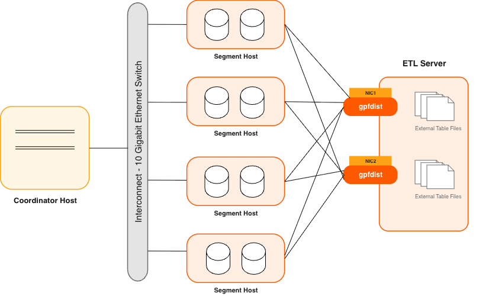

本教程简要介绍将示例数据 `FAA` 加载到上一教程[第 3 课：创建表](/cloudberry/tutorials/quick-trial-lessons/create-tables/)中创建的 Apache Cloudberry 表中的 3 种方法。继续之前，请确保已经完成上一教程。

- 方法 1：使用 `INSERT` 语句。这是加载数据最简单的方法。你可以直接在 psql 中执行 `INSERT`，运行包含 `INSERT` 语句的脚本，或运行连接数据库的客户端应用程序。不建议使用 `INSERT` 加载大量数据，因为加载效率较低。

- 方法 2：使用 SQL 语句 `COPY` 将数据加载到数据库。`COPY` 语法允许你定义文本文件的格式，以便将数据解析为行和列。这种方法比 `INSERT` 语句更快。但与 `INSERT` 语句一样，`COPY` 也不是并行数据加载过程。

    `COPY` 语句要求外部文件能够被运行 Coordinator 进程的主机访问。在多节点 Apache Cloudberry 系统中，数据文件可能位于 Coordinator 节点无法访问的文件系统上。此时需要使用 psql 命令 `\copy meta-command`，通过 `psql` 连接将数据流式传输到 Cloudberry Coordinator 节点。本教程中的一些示例脚本使用了 `\copy meta-command`。

- 方法 3：使用 Apache Cloudberry 工具将外部数据加载到表中。在大型数据仓库中工作时，你经常会面临在短时间内加载大量数据的挑战。工具 `gpfdist` 和 `gpload` 专为此目的设计，可实现快速的并行数据传输。

    数据加载过程中，如果某些行出现问题，系统会记录这些问题。你可以设置符合需求的错误阈值。如果问题行的数量超过该阈值，Apache Cloudberry 将停止加载过程。

    为获得最佳速度，可以将外部表与并行文件服务器（`gpfdist`）结合使用。这种方式有助于最大限度地提高效率，使数据加载任务更加顺畅、高效。

    
    _图 1：使用并行文件服务器（gpfdist）的外部表_

    另一个工具 `gpload` 是一个批处理作业。使用此工具时，应指定一个 YAML 格式的控制文件，并在文件中描述源数据位置、格式、所需转换、参与主机、数据库目标以及其他细节。`gpload` 会解析控制文件，并使用 `gpfdist` 执行任务。这样可以描述复杂任务，并以受控且可重复的方式执行任务。

## 快速开始操作 {#quick-start-operations}

下面的练习将使用上述每种方法把示例数据加载到 `tutorial` 数据库中。

### 使用 `INSERT` 加载数据 {#load-data-using-insert}

在[第 3 课：创建表](/cloudberry/tutorials/quick-trial-lessons/create-tables/)中，你已经在 `tutorial` 数据库中创建了 6 个表，其中一个是 `faa` 目录中的 `d_cancellation_codes`。

`faa.d_cancellation_codes` 表是一个简单的两列查找表。你将使用 `INSERT` 语句向该表加载数据。

<!-- You change to directory faa, containing FAA data and scripts, take a look at table faa.d_cancellation_codes, insert data into table.  -->

1. 以 `gpadmin` 用户在 Docker 中登录 Apache Cloudberry，并切换到 `faa` 目录。该目录包含 `faa` 数据和脚本。

    ```shell
    [gpadmin@cdw ~]$ cd /tmp/faa
    ```

2. 以 `lily` 用户登录 `tutorial` 数据库。

    ```shell
    [gpadmin@cdw faa]$ psql -U lily -d tutorial
    ```

    ```shell
    Password for user lily:  # changeme

    psql (14.4, server 14.4)
    Type "help" for help.

    tutorial=>
    ```

3. 检查 `faa.d_cancellation_codes` 表。

    ```sql
    tutorial=> \d d_cancellation_codes
    ```

    输出：

    ```sql
              Table "faa.d_cancellation_codes"
       Column    | Type | Collation | Nullable | Default
    -------------+------+-----------+----------+---------
     cancel_code | text |           |          |
     cancel_desc | text |           |          |
    Distributed by: (cancel_code)
    ```

4. 向 `faa.d_cancellation_codes` 表插入数据。

    ```sql
    tutorial=> INSERT INTO faa.d_cancellation_codes
    tutorial-> VALUES ('A', 'Carrier'),
    tutorial-> ('B', 'Weather'),
    tutorial-> ('C', 'NAS'),
    tutorial-> ('D', 'Security'),
    tutorial-> ('', 'none');
    ```

    输出：

    ```sql
    INSERT 0 5
    tutorial=>
    ```

### 使用 `COPY` 加载数据 {#load-data-using-copy}

`COPY` 语句将数据从文件系统移动到数据库表中。以下 CSV 格式文本文件中包含 5 个 `faa` 表的数据：

1. 在文本编辑器中打开并检查以下 `.csv` 数据文件。

    - `L_AIRLINE_ID.csv`
    - `L_AIRPORTS.csv`
    - `L_DISTANCE_GROUP_250.csv`
    - `L_ONTIME_DELAY_GROUPS.csv`
    - `L_WORLD_AREA_CODES.csv`

    请注意，每个文件的第一行包含列名，最后一行包含字符 `.`，表示输入数据结束。

2. 在文本编辑器中打开并检查以下 SQL 脚本：

    - `copy_into_airlines.sql`
    - `copy_into_airports.sql`
    - `copy_into_delay_groups.sql`
    - `copy_into_distance_groups.sql`
    - `copy_into_wac.sql`

3. 以 `lily` 用户登录 `tutorial` 数据库。

    ```shell
    [gpadmin@cdw faa]$ psql -U lily -d tutorial
    ```

    ```shell
    Password for user lily:  # changeme

    psql (14.4, server 14.4)
    Type "help" for help.

    tutorial=>
    ```

4. 运行以下 psql `\i` 命令，将数据加载到 `faa` 表中。

    ```sql
    tutorial=> \i copy_into_airlines.sql
    tutorial=> \i copy_into_airports.sql
    tutorial=> \i copy_into_delay_groups.sql
    tutorial=> \i copy_into_distance_groups.sql
    tutorial=> \i copy_into_wac.sql
    ```

    输出：

    ```sql
    COPY 1514
    COPY 1697
    COPY 15
    COPY 11
    COPY 342
    tutorial=>
    ```

### 使用 `gpdist` 工具加载数据 {#load-data-using-the-gpdist-utility}

对于 `faa` 事实表，你将使用 ETL（提取、转换、加载）过程，将源 gzip 文件中的数据加载到数据表中。为了获得最佳加载速度，请使用 `gpfdist` 工具将行分发到 Segment。

在生产系统中，`gpfdist` 运行在存放外部数据的文件服务器上。不过，对于单节点 Apache Cloudberry 实例，只有一个逻辑主机，因此也要在该主机上运行 `gpfdist`。启动 `gpfdist` 类似于启动文件服务器；在 SQL 查询请求结束前，不会发生数据移动。

> **注意：**
>
> 本练习使用 `gpfdist` 将外部数据文件中的数据移动到 Apache Cloudberry。数据库与外部表之间的数据移动也需要安全权限。因此，只有超级用户可以使用 `gpfdist`，本练习将以 `gpadmin` 用户完成。

1. 启动 `gpfdist`：

    ```shell
    [gpadmin@cdw tmp]$ gpfdist -d /tmp/faa -p 8081 > /tmp/gpfdist.log 2>&1 &
    ```

    在此操作中：

    - `-d /tmp/faa`：指定数据文件所在目录。该工具将从 `/tmp/faa` 提供文件。
    - `-p 8081`：设置 `gpfdist` 监听的端口，在此例中为端口 `8081`。
    - `> /tmp/gpfdist.log`：将标准输出重定向到 `/tmp/gpfdist.log` 日志文件。
    - `2>&1`：确保标准输出和标准错误都重定向到同一个日志文件。
    - `&`：在后台运行进程。

    执行后会看到 `6581`，表示后台作业编号 `[1]` 以及它的进程 ID `6581`。

2. 检查运行中的进程：

    ```shell
    [gpadmin@cdw tmp]$ ps -ef  |grep gpfdist
    ```

    该命令检查 `gpfdist` 是否正在运行：

    ```shell
    gpadmin   6581  6552  0 16:02 pts/8    00:00:00 gpfdist -d /tmp/faa -p 8081
    gpadmin   6585  6552  0 16:02 pts/8    00:00:00 grep --color=auto gpfdist
    ```

3. 查看日志文件：

    ```shell
    [gpadmin@cdw tmp]$ more /tmp/gpfdist.log
    ```

    该命令用于查看 `gpfdist.log` 文件内容。日志消息显示 `gpfdist` 工具的初始化步骤：

    ```shell
    2023-07-25 16:02:41 6581 INFO Before opening listening sockets - following listening sockets are available:
    2023-07-25 16:02:41 6581 INFO IPV6 socket: [::]:8081
    2023-07-25 16:02:41 6581 INFO IPV4 socket: 0.0.0.0:8081
    2023-07-25 16:02:41 6581 INFO Trying to open listening socket:
    2023-07-25 16:02:41 6581 INFO IPV6 socket: [::]:8081
    2023-07-25 16:02:41 6581 INFO Opening listening socket succeeded
    2023-07-25 16:02:41 6581 INFO Trying to open listening socket:
    2023-07-25 16:02:41 6581 INFO IPV4 socket: 0.0.0.0:8081
    2023-07-25 16:02:41 6581 INFO Opening listening socket succeeded
    Serving HTTP on port 8081, directory /tmp/faa
    ```

本节执行以下操作：

1. 设置必要的表。

    首先创建两个表：

    - `faa_otp_load`：将加载数据的表。
    - `faa_load_errors`：记录加载错误的表。

    这些操作只涉及元数据；此时不会传输实际数据。

    ```shell
    [gpadmin@cdw tmp]$ cd faa
    [gpadmin@cdw faa]$ psql -U gpadmin tutorial

    tutorial=# \i create_load_tables.sql
    ```

    注意：如果收到 `faa_load_errors` 表已存在的错误，可以安全地忽略它。

2. 从外部文件加载数据。

    `faa_otp_load` 表的结构与 `faa` 网站的输入数据格式一致。外部表定义将引用 `faa` 目录中符合 `otp*.gz` 模式的文件。在此示例中，有两个匹配文件，分别对应 2009 年 12 月和 2010 年 1 月。

    现在移动数据：

    ```shell
    tutorial=# \i create_ext_table.sql
    tutorial=# INSERT INTO faa.faa_otp_load SELECT * FROM faa.ext_load_otp;
    ```

    注意：Apache Cloudberry 负责将 gzip 文件中的数据移动到数据库的加载表中。在生产环境中，可能会运行多个 `gpfdist` 进程，可以分别运行在不同主机上，也可以在同一主机上运行多个进程，每个进程使用不同的端口。

3. 检查加载错误。

    数据加载期间出现错误很常见。下面检查这些错误，以便更好地理解它们。为清晰起见，将结果显示为每列数据占一行的格式：

    ```sql
    tutorial=# \x  -- Changes the display of the results to one line per column, which is easier to read for some result sets.
    tutorial=# select DISTINCT relname, errmsg, count(*) from gp_read_error_log('faa.ext_load_otp') GROUP BY 1,2;
    ```

    查看错误后，可以结束会话：

    ```sql
    tutorial=# \q
    [gpadmin@cdw faa]$
    ```

    总结：至此，你应该已经设置好表、加载好数据，并快速查看过加载错误。这有助于你理解数据的质量和结构。

### 使用 `gpload` 工具加载数据 {#load-data-using-the-gpload-utility}

Apache Cloudberry 提供了一个名为 `gpload` 的 `gpfdist` 封装程序，它可以完成设置外部表和数据移动的大部分工作。本练习将使用 gpload 工具重新加载 `faa_otp_load` 表。

本节将逐步介绍使用 `gpload` 加载数据的过程。步骤如下：

1. 确保环境干净。

    使用 `gpload` 前，确保前面任务启动的 `gpfdist` 进程都已停止。可以按以下方式检查并终止它们：

    ```shell
    [gpadmin@cdw faa]$ ps -ef | grep gpfdist
    [gpadmin@cdw faa]$ pkill gpfdist
    [gpadmin@cdw faa]$ ps -ef | grep gpfdist
    ```

2. 定制 `gpload` 输入文件。

    需要根据需求编辑和调整 `gpload.yaml` 输入文件。特别要确保为 `faa` 目录设置正确路径。本指南中的 `gpload.yaml` 文件包含 `TRUNCATE: true` 预加载指令，确保在当前加载开始前清除之前加载的数据。

    `gpload.yaml` 文件可能如下所示：

    ```shell
    [gpadmin@cdw faa]$ cat ./gpload.yaml

    ---
    VERSION: 1.0.0.1
    # describe the Greenplum database parameters
    DATABASE: tutorial
    USER: gpadmin
    HOST: cdw
    PORT: 5432
    # describe the location of the source files
    # in this example, the database coordinator lives on the same host as the source files
    GPLOAD:
    INPUT:
        - SOURCE:
            LOCAL_HOSTNAME:
            - cdw
            PORT: 8081
            FILE:
            - /tmp/faa/otp*.gz
        - FORMAT: csv
        - QUOTE: '"'
        - ERROR_LIMIT: 50000
        - ERROR_TABLE: faa.faa_load_errors
    OUTPUT:
        - TABLE: faa.faa_otp_load
        - MODE: INSERT
    PRELOAD:
        - TRUNCATE: true
    ```

3. 运行 `gpload` 命令。

    最后可以运行 gpload 命令开始数据加载过程。如果需要查看详细加载信息，请加入 -v 标志。

    ```shell
    [gpadmin@cdw faa]$ gpload -f gpload.yaml -l gpload.log
    ```

    总结：完成本指南后，你将成功使用 gpload 将数据加载到 Apache Cloudberry。请检查日志中的警告或错误，以确保数据一致性和完整性。

### 创建并加载事实表 {#create-and-load-fact-tables}

ELT 过程的最后一步是将数据从加载表移动到事实表。对于 `FAA` 示例，需要创建两个事实表。`faa.otp_r` 表是行存表，将从 `faa.faa_otp_load` 表加载数据。`faa.otp_c` 表与 `faa.otp_r` 表具有相同结构，但采用列存并进行了分区；它将从 `faa.otp_r` 表加载数据。两个表包含相同的数据，便于你在传统行存表之外，试验列存表和分区表。然后执行 `create_fact_tables.sql` 脚本创建 `faa.otp_r` 和 `faa.otp_c` 表。使用 `INSERT FROM` SQL 语句将数据从 `faa_otp_load` 表加载到 `faa.otp_r` 表，再从 `faa.otp_r` 表加载到 `faa.otp_c` 表。运行 `load_into_fact_table.sql` 脚本即可完成这两次加载。

```shell
[gpadmin@cdw faa]$ psql -U gpadmin tutorial

psql (14.4, server 14.4)
Type "help" for help.
```

```sql
tutorial=# \i create_fact_tables.sql
CREATE TABLE
CREATE TABLE

tutorial=#
tutorial=# \i load_into_fact_table.sql
INSERT 0 1024552
INSERT 0 1024552
tutorial=#
```

## 数据加载总结 {#data-loading-summary}

- 主要特性：快速数据加载

    - 提取、加载和转换（ELT）：这种方法利用 Apache Cloudberry 的大规模并行能力。
    - 暂存：可以使用外部表等方法暂存数据。
    - 转换：数据转换在 Apache Cloudberry 内部完成。
    - 性能：基于集合的操作并行执行，以最大限度地提高效率。

- 加载机制

    - `COPY`：通过 Coordinator 的单个进程加载数据，但不会利用 Apache Cloudberry 的并行能力。
    - 外部表：
        - 优势：利用 Segment 的并行处理能力。
        - 灵活性：一条 `SELECT` 语句可以访问多个数据源。
        - 数据可用性：使静态数据可以在数据库中访问。
        - 协议：使用 `file:// or gpfdist://` 定义。
        - `gpfdist`：并行加载文件服务器程序。
        - 静态数据：由于数据保持不变，查询期间可以重新扫描外部表。

- 外部 Web 表

    - 特性：
        - 协议：允许使用 `http://` 协议或 `EXECUTE` 子句执行操作系统命令或脚本。
        - 动态数据：假定数据可能在查询执行期间发生变化，因此不允许重新扫描。
        - 性能：如果数据超过内存容量，可能需要执行 I/O 操作，速度会变慢。
        - 执行：脚本或进程可能在每个 Segment 主机上运行。

    - 重复数据注意事项：
        - 存在数据重复的风险，尤其是在从另一个数据库提取数据时。
        - 使用 Web 表时，用户需要谨慎检查和验证数据。

有效理解和使用这些功能与机制，可以确保 Apache Cloudberry 中的数据加载和管理达到最佳效果。
