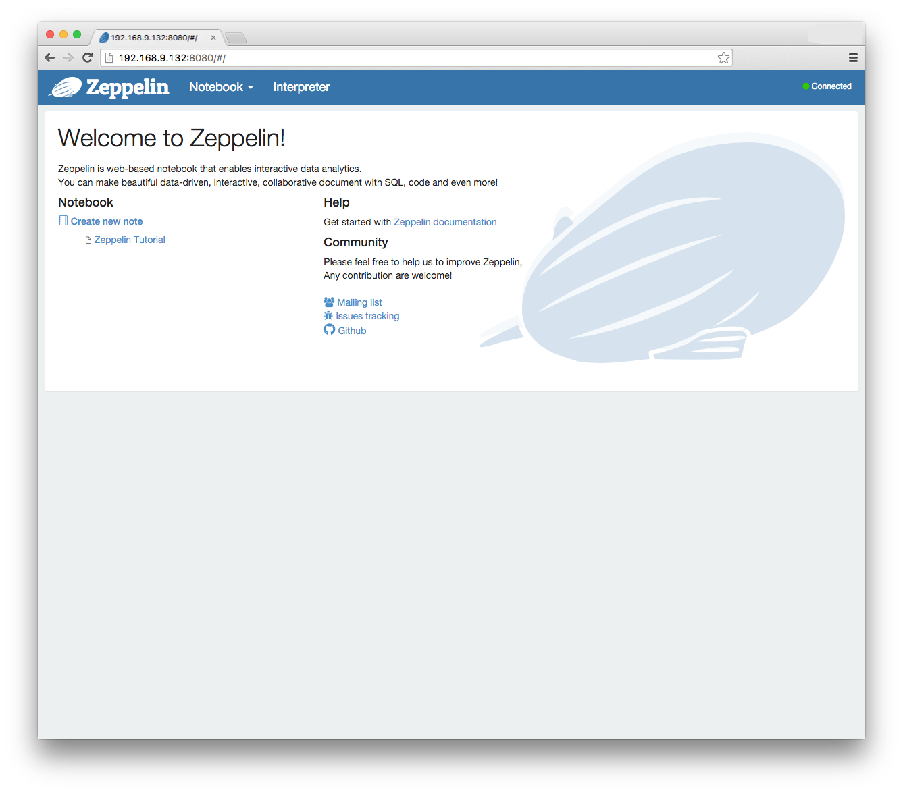
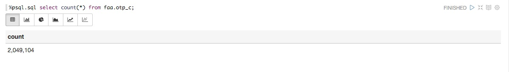

直接在 Apache Cloudberry 中运行分析，而不是将数据导出到独立的分析引擎，可以在探索大型数据集时获得更高的灵活性；由于分析过程可以在所有 Segment 之间并行执行，性能也会显著提高。

Apache Cloudberry 支持使用多种强大的分析工具：

* MADlib：开源的 MPP 分析算法实现，提供于 [http://madlib.apache.org/](http://madlib.apache.org/)
* R 统计语言
* SAS 的多种形式，尤其是用于 Cloudberry 的 SAS Accelerator
* PMML（预测模型标记语言）

本章的练习使用 FAA 准点数据示例数据集，介绍如何将 MADlib 与 Apache Cloudberry 结合使用。你将比较航空公司和机场的多个场景，以了解其中是否存在显著关系。

本课将使用 [Apache Zeppelin](https://zeppelin.apache.org/) 向 Apache Cloudberry 提交 SQL 语句。Apache Zeppelin 是一个基于 Web 的笔记本，可进行交互式数据分析。Zeppelin 已加入 [PostgreSQL 解释器](https://issues.apache.org/jira/browse/ZEPPELIN-250)，因此现在可以直接与 Pivotal Apache Cloudberry 和 Pivotal HDB 等产品协同工作。

## 准备 Apache Zeppelin {#prepare-apache-zeppelin}

1. 在桌面上打开浏览器，使用 SSH 步骤中使用的同一个 IP 地址访问 `http://X.X.X.X:8080`。你将看到 Apache Zeppelin 欢迎页面。

    

2. 点击屏幕顶部的 Interpreter，向下滚动到 psql 部分，然后点击 edit。

3. 编辑 _postgresql.url_ 条目，在末尾添加 tutorial，使其连接到 <strong>tutorial</strong> 数据库。
4. 点击 Save，然后点击 OK 重启解释器。
5. 点击 Notebook 标题下的 Create new note，并输入：`tutorial`

    

6. 点击“tutorial”打开刚创建的笔记本。

7. 此时应看到已打开的笔记本，其中有一个等待输入的“段落”。点击空白矩形（称为 paragraph），输入：

    ```sql
    %psql.sql select count(*) from faa.otp.c;
    ```

    然后点击播放按钮：

    

    结果应类似下方图示：

    

## 运行 PostgreSQL 内置聚合函数 {#run-postgresql-built-in-aggregates}

PostgreSQL 内置聚合函数可以获取数据库列的标准统计信息，例如最小值、最大值、平均值和标准差。这些函数利用 Apache Cloudberry MPP 架构，先在 Segment 上聚合数据，然后在 Coordinator 上汇总结果。

首先，收集一些将使用 MADlib 分析的数据的简单描述性统计信息。本练习中的命令位于示例数据目录的 stats.sql 脚本中。

1. 获取 USAir 和 Delta 航空公司的平均延误、标准差和航班数量。点击一个新的白色矩形并输入：

    ```sql
    %psql.sql SELECT carrier, AVG(arrdelayminutes),STDDEV(arrdelayminutes),
    COUNT(*) FROM faa.otp_c WHERE carrier = 'US' OR carrier = 'DL'
    GROUP BY carrier;
    ```

    然后点击播放按钮执行查询。

2. 获取从芝加哥奥黑尔机场或亚特兰大哈茨菲尔德机场出发的航班的平均延误、标准差和数量。点击一个新的白色矩形并输入：

    ```sql
    %psql.sql SELECT origin, AVG(arrdelayminutes),STDDEV(arrdelayminutes),
    COUNT(*) FROM faa.otp_c WHERE origin = 'ORD' OR origin = 'ATL'
    GROUP BY origin;
    ```

    然后点击播放按钮执行查询。

3. 获取从芝加哥奥黑尔机场或亚特兰大哈茨菲尔德机场出发的航班的平均延误、标准差和数量。点击一个新的白色矩形并输入：

    ```sql
    %psql.sql SELECT origin, AVG(arrdelayminutes),STDDEV(arrdelayminutes),
    COUNT(*) FROM faa.otp_c WHERE carrier = 'DL' AND origin IN ('ATL', 'MSP',
    'DTW') GROUP BY origin;
    ```

    然后点击播放按钮执行查询。

4. 获取从亚特兰大哈茨菲尔德机场出发的 Delta 和 USAir 航班的平均延误、标准差和数量。点击一个新的白色矩形并输入：

    ```sql
    %psql.sql SELECT carrier, AVG(arrdelayminutes),STDDEV(arrdelayminutes),
    COUNT(*) FROM faa.otp_c WHERE carrier IN ('DL', 'UA') AND origin = 'ATL'
    GROUP BY carrier;
    ```

    然后点击播放按钮执行查询。

## 运行 Apache MADlib ANOVA {#run-apache-madlib-anova}

ANOVA（方差分析）用于判断样本组之间是否存在显著差异。MADlib 的 ANOVA 函数使用整数值区分要比较的组，并使用一列作为数据。我们要分析的 FAA 事实表中的分组是文本值，因此使用 PostgreSQL CASE 语句根据文本值为样本分配整数值。ANOVA 模块随后将行划分为各组并执行检验。

ANOVA 是一种一般线性模型。要判断统计数据样本之间是否存在显著差异，需要将组的总变异性与组间变异性进行比较。这个比较还要结合观测数量，观测数量由组内自由度概括。衡量组间差异显著程度的相关统计量，是组间方差除以组内方差得到的比值，称为 F 统计量。若该值接近零，说明各组差异不大；若该值远离零，则说明各组存在差异。

根据统计理论，如果各组相同，可以在考虑抽样误差的情况下确定 F 统计量的概率分布。这就是 p 值。接近零的 p 值表示各组很可能不同；接近一的 p 值表示各组很可能相同。

1. 对 USAir 和 Delta 航空公司的平均延误分钟数执行 ANOVA 分析。CASE 子句将 USAir 航班分配到第 1 组，将 Delta 航班分配到第 2 组。

    点击一个新的白色矩形并输入：

    ```sql
    %psql.sql  SELECT (MADlib.one_way_anova (
    CASE WHEN carrier = 'US' THEN 1
    WHEN carrier = 'DL' THEN 2
    ELSE NULL
    END,
    arrdelayminutes
    )).* FROM faa.otp_r;
    ```

    然后点击播放按钮执行查询。

2. 执行 ANOVA 分析，判断从芝加哥和亚特兰大出发的航班平均延误是否存在统计学差异。

    点击一个新的白色矩形并输入：

    ```sql
    %psql.sql  SELECT (MADlib.one_way_anova (
    CASE WHEN origin = 'ORD' THEN 1
    WHEN origin = 'ATL' THEN 2
    ELSE NULL
    END,
    arrdelayminutes
    )).* FROM faa.otp_r;
    ```

    然后点击播放按钮执行查询。

3. 执行 ANOVA 分析，判断 Delta 三个枢纽机场的平均延误分钟数差异是否显著。

    点击一个新的白色矩形并输入：

    ```sql
    %psql.sql   SELECT (MADlib.one_way_anova (
    CASE WHEN carrier = 'DL' AND origin = 'ATL' THEN 1
    WHEN carrier = 'DL' AND origin = 'MSP' THEN 2
    WHEN carrier = 'DL' AND origin = 'DTW' THEN 3
    ELSE NULL
    END,
    arrdelayminutes
    )).* FROM faa.otp_r;
    ```

    然后点击播放按钮执行查询。

4. 执行 ANOVA 分析，判断从亚特兰大出发的 Delta 和 USAir 航班平均延误分钟数差异是否显著。

    点击一个新的白色矩形并输入：

    ```sql
    %psql.sql  SELECT (MADlib.one_way_anova (
    CASE WHEN carrier = 'DL' AND origin = 'ATL' THEN 1
    WHEN carrier = 'UA' AND origin = 'ATL' THEN 2
    ELSE NULL
    END,
    arrdelayminutes
    )).* FROM faa.otp_r;
    ```

    然后点击播放按钮执行查询。

    从这些 ANOVA 分析中可以得出以下结论：

    * USAir 和 Delta 的延误存在较为确定的差异，但差异并不大。
    * 奥黑尔机场的延误似乎与亚特兰大机场存在显著差异。
    * Delta 三个枢纽机场的延误存在较大差异。
    * 在亚特兰大机场，United 和 Delta 的延误没有显著差异。

## 执行线性回归 {#perform-linear-regression}

线性回归用于展示变量之间的关系。一个经典例子是某个国家或族群的成年男性身高与体重之间的线性关系。MADlib 包含执行线性回归的模块，支持一个或多个自变量。

r2 统计量表示因变量的总变异中可以由自变量解释的比例。

1. 执行线性回归，查看距离与到达延误之间是否存在关系。这是在检验一个假设：较长的航班更有可能准点，因为机组可以在较长的飞行过程中通过加速飞行弥补延误。可以将到达时间作为因变量、距离作为自变量运行回归来检验这一点。

    点击一个新的白色矩形并输入：

    ```sql
    %psql.sql SELECT ( madlib.linregr(arrdelayminutes,
    ARRAY[1,distance])).* FROM faa.otp_c;
    ```

    然后点击播放按钮执行查询。

    回归结果显示 r2 接近零，说明距离不是到达延误时间的良好预测变量。

2. 以出发延误时间为自变量、到达延误时间为因变量运行回归。这是在检验另一个假设：如果航班晚点起飞，机组不太可能弥补这段时间。

    点击一个新的白色矩形并输入：

    ```sql
    %psql.sql  SELECT ( madlib.linregr(arrdelayminutes,
    ARRAY[1,depdelayminutes])).* FROM faa.otp_c;
    ```

    然后点击播放按钮执行查询。

    r2 统计量非常高，尤其是在有 150 万个样本的情况下。线性关系可以写为

    `Arrival_delay = 1.2502729312843388 + 0.96360804792526189 * departure_delay`

    如果在结果中横向滚动，condition_no 结果衡量的是解的数学稳定性。在计算机算术中，数字没有无限精度，计算中的舍入误差可能很明显，尤其是自变量数量很多且彼此高度相关时。在计量经济学数据中，这种情况十分常见，人们也已发展出相应技术来处理它。

## 进一步了解 Apache MADlib {#learn-more-about-apache-madlib}

MADlib 是 Apache 基金会的开源 GitHub 项目。你可以在 GitHub 仓库中找到最新版本的源代码以及参与项目的信息。可以在 MADlib 网站的 [MADlib 用户文档](http://madlib.apache.org/)中访问用户文档。
