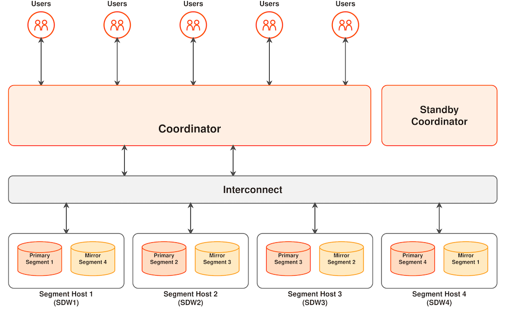

## 背景：数据库概念 {#background-database-concepts}

开始本教程前，请先花些时间熟悉（单实例）数据库的工作方式。如果你已经了解并使用过 Oracle、MySQL，尤其是 Postgres，那就更好了。

数据库（关系数据库）是用于存储、管理和处理数据的软件。通常，数据库采用客户端/服务器模式构建：数据库作为服务器运行，多个客户端可以连接到服务器并读取或更新数据。

客户端通常使用 SQL 语言（或某种 SQL 语言规范方言）访问数据。客户端可以采用不同实现，例如专有客户端库，或符合 ODBC/JDBC 规范的客户端。

数据库数据通常存储在称为表的对象中。表具有预定义的结构（列），并且可以包含零行或多行。

表可以归入称为“模式”（或命名空间）的逻辑实体中。

表和模式位于“数据库”实体中。有些数据库软件支持每个实例包含多个数据库（MySQL、Postgres），另一些软件则每个实例只支持一个数据库（Oracle）。

除表之外，数据库还包含索引、序列、视图等辅助对象。

数据库系统需要维护一些元数据，这些元数据称为数据库目录。数据库目录包含数据对象和辅助对象的信息，以及所有需要在系统级别存储的信息（例如用户身份验证）。

SQL（结构化查询语言）是一种描述性语言，而不是命令式语言。因此，它描述用户需要什么，而不是如何获取这些结果。当用户描述需求后，数据库需要决定如何获取结果。这个过程称为查询优化，最终结果是查询计划，即获取结果的一系列分步指令。

## Apache Cloudberry 架构简介 {#introduction-to-the-apache-cloudberry-architecture}

Apache Cloudberry 是一种大规模并行处理（MPP）数据库服务器，其架构专门用于管理大型分析型数据仓库和商业智能工作负载。

MPP（也称为无共享架构）指由两个或更多处理器协作完成操作的系统，每个处理器拥有自己的内存、操作系统和磁盘。Apache Cloudberry 使用这种高性能系统架构，将多 TB 数据仓库的负载以及系统的所有资源并行分配，用于处理查询。

Apache Cloudberry 基于开源 PostgreSQL。本质上，它是多个 PostgreSQL 数据库实例协同工作，组成一个统一的数据库管理系统（DBMS）。它基于 PostgreSQL 14.4 内核，在大多数情况下与 PostgreSQL 非常相似。数据库用户可以像使用普通 PostgreSQL DBMS 一样与 Apache Cloudberry 交互。

在 Apache Cloudberry 中，PostgreSQL 的内部组件经过修改和优化，以支持 Apache Cloudberry 的并行结构。例如，系统目录、优化器、查询执行器和事务管理器组件都经过修改和增强，可以在并行的 PostgreSQL 数据库实例之间同时执行查询。Apache Cloudberry Interconnect（网络层）负责在不同 PostgreSQL 实例之间通信，使整个系统表现为一个逻辑数据库。

Apache Cloudberry 还包含用于优化 PostgreSQL 商业智能（BI）工作负载的功能。例如，Apache Cloudberry 增加了并行数据加载（外部表）、资源管理、查询优化和存储增强功能。

_图 1：Apache Cloudberry 高层架构_

以下主题介绍 Apache Cloudberry 系统的组成部分以及它们如何协同工作。

### Apache Cloudberry Coordinator {#apache-cloudberry-coordinator}

Apache Cloudberry Coordinator 是进入 Apache Cloudberry 系统的入口。它接受客户端连接、处理 SQL 查询，然后将工作负载分发给 Segment 实例。

Apache Cloudberry 最终用户像使用典型 PostgreSQL 数据库一样，只通过 Coordinator 节点与 Apache Cloudberry 交互。他们使用 `psql` 等客户端，或 `JDBC`、`ODBC` 等驱动程序连接数据库。

Coordinator 存储全局系统目录。全局系统目录是一组系统表，其中包含 Apache Cloudberry 本身的元数据。Coordinator 节点不包含任何用户表数据；用户表数据只存储在 Segment 上。Coordinator 节点负责验证客户端连接、处理传入的 SQL 命令、在 Segment 之间分发工作负载、收集各 Segment 返回的结果，并将最终结果返回给客户端。

### Apache Cloudberry Segment {#apache-cloudberry-segments}

Apache Cloudberry Segment 实例是相互独立的 PostgreSQL 数据库，每个实例存储一部分数据，并执行大部分查询工作。

用户通过 Cloudberry Coordinator 连接数据库并发出查询时，相应的执行计划会分发到每个 Segment 实例。

运行 Segment 的服务器称为 Segment 主机。一台 Segment 主机通常运行两个到八个 Cloudberry Segment，具体数量取决于 CPU 核数、内存、磁盘、网络接口和工作负载等因素。为了获得更好的 Apache Cloudberry 性能，建议在 Segment 之间均匀分布数据和工作负载，使执行计划能够在所有 Segment 上完成且不产生瓶颈。

### Apache Cloudberry Interconnect {#apache-cloudberry-interconnect}

Interconnect 是 Apache Cloudberry 架构的网络层。

Interconnect 是 Segment 之间的进程间通信机制。默认情况下，Interconnect 使用用户数据报协议（UDP）在网络上发送和接收消息。Interconnect 提供数据报验证和重传机制，其可靠性相当于传输控制协议（TCP），而性能和可扩展性超过 TCP。如果用户在 Interconnect 中选择 TCP，Cloudberry 会将 Segment 实例数量限制在约 1000 个。使用 UDP 和 Interconnect 时则不存在这一限制。
