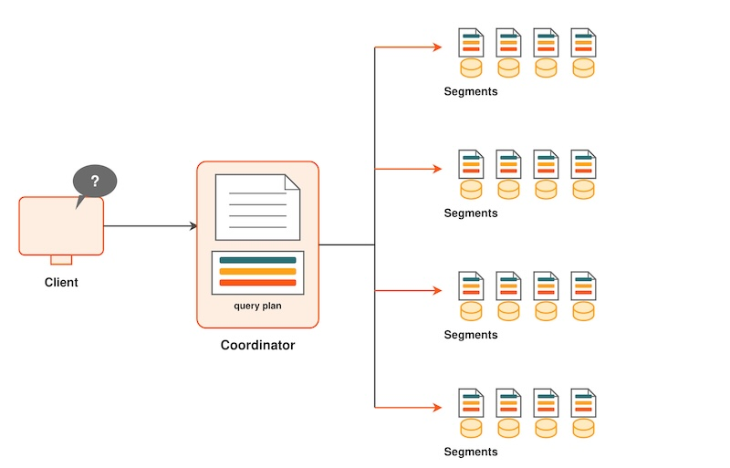
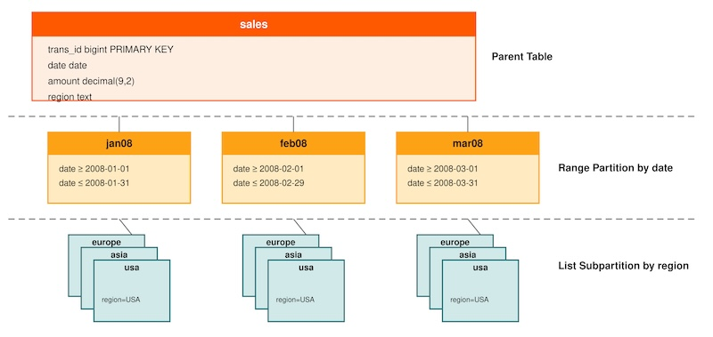

本课概述 Apache Cloudberry 处理查询的过程。理解这一过程，有助于编写查询并进行调优。

## 概念 {#concepts}

向 Apache Cloudberry 提交查询的方式与其他数据库管理系统相同。用户使用 psql 等客户端应用程序，连接到 Apache Cloudberry Coordinator 主机上的数据库实例，然后提交 SQL 语句。

### 了解查询规划与分发 {#understand-query-planning-and-dispatch}

Coordinator 主机接收、解析并优化查询。生成的查询计划可以是并行计划，也可以是定向计划。Coordinator 将并行查询计划分发到所有 Segment，如图 1 所示。每个 Segment 负责针对自己的数据执行查询计划中的本地数据库操作。

表扫描、连接、聚合和排序等大多数数据库操作都会在所有 Segment 上并行执行。每个操作在一个 Segment 数据库上独立执行，不依赖其他 Segment 数据库中存储的数据。

_图 1. 分发并行查询计划_



### 了解查询计划 {#understand-query-plans}

查询计划是 Apache Cloudberry 为得出查询结果而执行的一组操作。计划中的每个节点或步骤代表一种数据库操作，例如表扫描、连接、聚合或排序。计划的阅读和执行顺序都是自下而上。

除了表扫描和连接等常见数据库操作，Apache Cloudberry 还有一种称为“Motion”的操作类型。Motion 操作在查询处理期间，在 Segment 之间移动元组。

为了在查询执行期间实现最大程度的并行，Apache Cloudberry 将查询计划的工作划分为多个切片（slice）。切片是 Segment 可以独立处理的一部分计划。查询计划在每个 Motion 操作处切分，Motion 两侧各有一个切片。

### 了解并行查询执行 {#understand-parallel-query-execution}

Apache Cloudberry 创建多个数据库进程来处理查询工作。在 Coordinator 上，查询工作进程称为“查询分发器”（query dispatcher，QD）。QD 负责创建和分发查询计划，还负责汇总并呈现最终结果。在 Segment 上，查询工作进程称为“查询执行器”（query executor，QE）。QE 负责完成分配给自己的工作，并将中间结果传递给其他工作进程。

查询计划的每个切片至少分配一个工作进程。每个工作进程独立执行分配给自己的那部分查询计划。查询执行期间，每个 Segment 上都会有多个进程并行处理该查询。

在不同 Segment 上处理同一查询计划切片的相关进程组成“进程组”（gang）。一部分工作完成后，元组沿查询计划向上，从一个进程组流向下一个进程组。Segment 之间的这种进程间通信由 Apache Cloudberry 的 Interconnect 组件实现。

下文介绍 Apache Cloudberry 查询与性能调优的一些基本原则。

性能调优需要考虑的事项包括：

- VACUUM 和 ANALYZE
- 执行计划
- 索引
- 列存储或行存储
- 基于集合的操作与逐行操作
- 分布与分区

## 练习 {#exercises}

完成以下练习后，应完成前一篇教程[第 4 课：数据加载](/cloudberry/tutorials/quick-trial-lessons/data-loading/)。

### 分析表 {#analyze-the-tables}

Apache Cloudberry 使用多版本并发控制（MVCC）来保证数据隔离性，这是关系数据库 ACID 特性之一。即使查询执行期间数据正在发生变化，MVCC 也能让多个数据库用户获得一致的查询结果。数据库中的行可以存在多个版本，但查询看到的是数据库在单一时间点的快照，只包含该时间点有效的行版本。某行被更新或删除后，如果没有活跃事务继续引用它，就可以将其移除。`VACUUM` 命令移除不再需要的旧版本，留下可供重用的空闲空间。

在 Apache Cloudberry 中，常规 OLTP 操作不会产生需要清理的旧行，但在表使用期间加载数据可能产生这样的需求。最佳实践是在加载后对表执行 `VACUUM`。如果表已分区，且只更改一个分区，那么只对该分区执行 `VACUUM` 可能就足够了。

`VACUUM FULL` 与 `VACUUM` 的行为很不一样，不建议在 Apache Cloudberry 中使用。它可能消耗大量 CPU 和 I/O 资源，导致索引膨胀，并长时间锁定数据。

ANALYZE 命令生成表中数据分布的统计信息，尤其会保存各列值的直方图。查询优化器依靠这些统计信息，选择执行查询的最佳计划。例如，优化器可以使用分布数据决定连接顺序。对于连接操作，优化器的目标之一是利用统计信息，优先处理最小的结果集，从而尽量减少需要分析、以及可能需要在 Segment 之间移动的数据量。

1. 以 `gpadmin` 身份连接数据库，对每张表运行 `ANALYZE` 命令：

    ```shell
    $ psql -U gpadmin tutorial
    ```

    ```sql
    tutorial=# ANALYZE faa.d_airports;
    ANALYZE
    tutorial=# ANALYZE faa.d_airlines;
    ANALYZE
    tutorial=# ANALYZE faa.d_wac;
    ANALYZE
    tutorial=# ANALYZE faa.d_cancellation_codes;
    ANALYZE
    tutorial=# ANALYZE faa.faa_otp_load;
    ANALYZE
    tutorial=# ANALYZE faa.otp_r;
    ANALYZE
    tutorial=# ANALYZE faa.otp_c;
    ANALYZE
    ```

### 查看 `EXPLAIN` 计划 {#view-explain-plans}

`EXPLAIN` 计划展示优化器选择用来生成结果集的方法。根据查询的不同，生成结果集可能有多种方法。优化器计算每种方法的代价，并选择代价最低的方法。对于大型查询，代价通常用需要执行的 I/O 量来衡量。

`EXPLAIN` 计划不会实际执行查询。执行计划使用 `ANALYZE` 命令生成的统计信息，因此运行 `ANALYZE` 前后生成的计划可能大不相同。包含多个连接的查询尤其如此，因为连接顺序可能显著影响性能。

在下面的练习中，你将生成一些小表，对其执行查询，并查看执行计划。

1. 启用计时，以便观察不同性能调优措施的效果。

    ```sql
    tutorial=# \timing on
    ```

2. 查看 `create_sample_table.sql` 脚本，然后运行它。

    ```sql
    tutorial=# \i create_sample_table.sql
    ```

    ```sql
    psql:create_sample_table.sql:1: NOTICE:  table "sample" does not exist, skipping
    DROP TABLE
    Time: 8.996 ms
    SET
    Time: 0.509 ms
    CREATE TABLE
    Time: 20.419 ms
    INSERT 0 1000000
    Time: 28598.022 ms (00:28.598)
    UPDATE 1000000
    Time: 5176.394 ms (00:05.176)
    UPDATE 50000
    Time: 408.038 ms
    UPDATE 1000000
    Time: 3148.945 ms (00:03.149)
    ```

3. 查看 `COUNT()` 聚合的执行计划。

    ```sql
    tutorial=# EXPLAIN SELECT COUNT(*) FROM sample WHERE id > 100;
    ```

    ```sql
            QUERY PLAN
    ------------------------------------------------------------------------------------
    Aggregate  (cost=0.00..431.00 rows=1 width=8)
    ->  Gather Motion 2:1  (slice1; segments: 2)  (cost=0.00..431.00 rows=1 width=1)
            ->  Seq Scan on sample  (cost=0.00..431.00 rows=1 width=1)
                Filter: (id > 100)
    Optimizer: Pivotal Optimizer (GPORCA)
    (5 rows)

    Time: 5.635 ms
    ```

    应自下而上阅读查询计划。本例包含 4 个步骤。首先，在每台 Segment 服务器上执行顺序扫描以访问数据行；然后在每台 Segment 服务器上执行聚合，统计该 Segment 的行数；接着将计数值汇集到一个位置；最后聚合各 Segment 的计数，得到最终结果。

    每个步骤的代价都有起始值和结束值。对于顺序扫描，起始值为零，结束值为 431.00。这是优化器估算出来的数值，并不表示秒数或 I/O 操作次数。

    代价会累加，因此第二个操作的代价包含第一个操作的代价。请注意，处理该查询的时间几乎都花在顺序扫描上。

4. `EXPLAIN ANALYZE` 命令会实际运行查询（但不返回结果集）。代价值反映实际耗时。它还会生成一些内存和 I/O 统计信息。

    ```sql
    tutorial=# EXPLAIN ANALYZE SELECT COUNT(*) FROM sample WHERE id > 100;
    ```

    ```sql
                                QUERY PLAN
    ----------------------------------------------------------------------------------------------------------------------------------
    Finalize Aggregate  (cost=0.00..463.54 rows=1 width=8) (actual time=329.600..329.602 rows=1 loops=1)
    ->  Gather Motion 2:1  (slice1; segments: 2)  (cost=0.00..463.54 rows=1 width=8) (actual time=325.897..329.586 rows=2 loops=1)
            ->  Partial Aggregate  (cost=0.00..463.54 rows=1 width=8) (actual time=324.713..324.716 rows=1 loops=1)
                ->  Seq Scan on sample  (cost=0.00..463.54 rows=499954 width=1) (actual time=30.992..296.384 rows=500184 loops=1)
                        Filter: (id > 100)
                        Rows Removed by Filter: 53
    Planning Time: 5.192 ms
    (slice0)    Executor memory: 37K bytes.
    (slice1)    Executor memory: 122K bytes avg x 2 workers, 122K bytes max (seg0).
    Memory used:  128000kB
    Optimizer: Pivotal Optimizer (GPORCA)
    Execution Time: 338.004 ms
    (12 rows)

    Time: 343.866 ms
    ```

### 切换优化器 {#change-optimizers}

默认情况下，沙箱实例禁用 Pivotal 查询优化器，你可能在 `EXPLAIN` 输出的“Optimizer status”项下看到“legacy query optimizer”。

1. 检查 Pivotal 查询优化器是否已启用。

    ```shell
    $ gpconfig -s optimizer
    ```

    ```shell
    Values on all segments are consistent
    GUC              : optimizer
    Coordinator value: on
    Segment     value: on
    ```

2. 禁用 Pivotal 查询优化器。

    ```shell
    $ gpconfig -c optimizer -v off --coordinatoronly
    ```

    ```shell
    20230726:14:42:31:031343 gpconfig:cdw:gpadmin-[INFO]:-completed successfully with parameters '-c optimizer -v on --coordinatoronly'
    ```

3. 在 Coordinator 和 Segment 实例上重新加载配置。

    ```shell
    $ gpstop -u
    ```

    ```shell
    20230726:14:42:49:031465 gpstop:cdw:gpadmin-[INFO]:-Starting gpstop with args: -u
    20230726:14:42:49:031465 gpstop:cdw:gpadmin-[INFO]:-Gathering information and validating the environment...
    20230726:14:42:49:031465 gpstop:cdw:gpadmin-[INFO]:-Obtaining Cloudberry Coordinator catalog information
    20230726:14:42:49:031465 gpstop:cdw:gpadmin-[INFO]:-Obtaining Segment details from coordinator...
    20230726:14:42:49:031465 gpstop:cdw:gpadmin-[INFO]:-Cloudberry Version: 'postgres (Apache Cloudberry) 1.0.0 build dev'
    20230726:14:42:49:031465 gpstop:cdw:gpadmin-[INFO]:-Signalling all postmaster processes to reload
    ```

### 索引与性能 {#indexes-and-performance}

Apache Cloudberry 对索引的依赖程度不像传统数据仓库系统那样高。Segment 并行执行表扫描，每个 Segment 只扫描表的一小部分，因此索引的传统性能优势不再存在。索引占用大量空间，并且在数据加载时需要消耗相当多的 CPU 时间进行计算。不过，索引在某些情况下仍然有用，尤其是选择性很高的查询。查询查找单行数据时，索引可以大幅提高性能。

在本练习中，你将使用传统优化器，了解索引如何提高性能。先在没有索引的示例表上查找单行数据，再创建索引并重新运行查询。

```sql
tutorial=# SELECT * FROM sample WHERE big = 12345;

  id   |  big  | wee | stuff
-------+-------+-----+-------
 12345 | 12345 |   0 |
(1 row)

Time: 251.304 ms
tutorial=#
tutorial=# EXPLAIN SELECT * FROM sample WHERE big = 12345;

                                   QUERY PLAN
--------------------------------------------------------------------------------
 Gather Motion 2:1  (slice1; segments: 2)  (cost=0.00..8552.02 rows=1 width=15)
   ->  Seq Scan on sample  (cost=0.00..8552.00 rows=1 width=15)
         Filter: (big = 12345)
 Optimizer: Postgres query optimizer
(4 rows)

Time: 0.709 ms
tutorial=#
tutorial=#
tutorial=# CREATE INDEX sample_big_index ON sample(big);

CREATE INDEX
Time: 1574.117 ms (00:01.574)
tutorial=#
tutorial=#
tutorial=# SELECT * FROM sample WHERE big = 12345;
  id   |  big  | wee | stuff
-------+-------+-----+-------
 12345 | 12345 |   0 |
(1 row)

Time: 2.774 ms
tutorial=# EXPLAIN SELECT * FROM sample WHERE big = 12345;
                                      QUERY PLAN
--------------------------------------------------------------------------------------
 Gather Motion 2:1  (slice1; segments: 2)  (cost=0.17..8.21 rows=1 width=15)
   ->  Index Scan using sample_big_index on sample  (cost=0.17..8.19 rows=1 width=15)
         Index Cond: (big = 12345)
 Optimizer: Postgres query optimizer
(4 rows)

Time: 0.627 ms
```

注意使用索引和不使用索引时，单行 `SELECT` 查询的耗时差异。对于更大的表，这一差异会更大，因为索引可以提高大型数据集上查询的性能。请注意，即使存在索引，优化器也可能因为有更高效的计划而选择不使用它。

查看以下 `EXPLAIN` 计划，比较其他常见查询类型的执行计划。

```sql
tutorial=# EXPLAIN SELECT * FROM sample WHERE big = 12345;
tutorial=# EXPLAIN SELECT * FROM sample WHERE big > 12345;
tutorial=# EXPLAIN SELECT * FROM sample WHERE big = 12345 OR big = 12355;
tutorial=# DROP INDEX sample_big_index;
tutorial=# EXPLAIN SELECT * FROM sample WHERE big = 12345 OR big = 12355;
```

### 行存储与列存储 {#row-vs-column-orientation}

Apache Cloudberry 支持将表存储为行存储或列存储。两种方式各有优势，具体取决于数据压缩特性、执行的查询类型、行长度，以及连接列的复杂程度和数量。

一般而言，非常宽的表更适合行存储，尤其是涉及许多连接列时。如果列中有大量重复数据，列存储可以通过压缩节省空间，并减少 I/O。

在本练习中，你将创建事实表的列存储版本，并与行存储版本进行比较。

1. 创建 FAA 航班准点率事实表的列存储版本，并插入行存储版本中的数据。

    ```sql
    tutorial=# CREATE TABLE FAA.OTP_C (LIKE faa.otp_r) WITH (appendonly=true,
    orientation=column)
    DISTRIBUTED BY (UniqueCarrier, FlightNum) PARTITION BY RANGE(FlightDate)
    ( PARTITION mth START('2009-06-01'::date) END ('2010-10-31'::date)
    EVERY ('1 mon'::interval));
    CREATE TABLE
    tutorial=#
    ```

    ```sql
    tutorial=# INSERT INTO faa.otp_c SELECT * FROM faa.otp_r;
    INSERT 0 1024552
    ```

2. 比较表的行存储版本与列存储版本的定义。

    ```sql
    tutorial=# \d faa.otp_r

                    Table "faa.otp_r"
           Column        |       Type       | Collation | Nullable | Default
   ----------------------+------------------+-----------+----------+---------
    flt_year             | smallint         |           |          |
    flt_quarter          | smallint         |           |          |
    flt_month            | smallint         |           |          |
    flt_dayofmonth       | smallint         |           |          |
    flt_dayofweek        | smallint         |           |          |
    flightdate           | date             |           |          |
    uniquecarrier        | text             |           |          |
    airlineid            | integer          |           |          |
    carrier              | text             |           |          |
    flightnum            | text             |           |          |
    origin               | text             |           |          |
    origincityname       | text             |           |          |
    originstate          | text             |           |          |
    originstatename      | text             |           |          |
    dest                 | text             |           |          |
    destcityname         | text             |           |          |
    deststate            | text             |           |          |
    deststatename        | text             |           |          |
    crsdeptime           | text             |           |          |
    deptime              | integer          |           |          |
    depdelay             | double precision |           |          |
    depdelayminutes      | double precision |           |          |
    departuredelaygroups | smallint         |           |          |
    taxiout              | smallint         |           |          |
    wheelsoff            | text             |           |          |
    wheelson             | text             |           |          |
    taxiin               | smallint         |           |          |
    crsarrtime           | text             |           |          |
    arrtime              | text             |           |          |
    arrdelay             | double precision |           |          |
    arrdelayminutes      | double precision |           |          |
    arrivaldelaygroups   | smallint         |           |          |
    cancelled            | smallint         |           |          |
    cancellationcode     | text             |           |          |
    diverted             | smallint         |           |          |
    crselapsedtime       | integer          |           |          |
    actualelapsedtime    | double precision |           |          |
    airtime              | double precision |           |          |
    flights              | smallint         |           |          |
    distance             | double precision |           |          |
    distancegroup        | smallint         |           |          |
    carrierdelay         | smallint         |           |          |
    weatherdelay         | smallint         |           |          |
    nasdelay             | smallint         |           |          |
    securitydelay        | smallint         |           |          |
    lateaircraftdelay    | smallint         |           |          |
    Distributed by: (uniquecarrier, flightnum)
    ```

    请注意，列存储版本采用只追加存储，并进行了分区。它有 17 个分区子文件，分别对应 2009 年 6 月至 2010 年 10 月的各个月份。

    ```sql
    tutorial=# \d+ faa.otp_c
    ```

    ```sql
                                                    Partitioned table "faa.otp_c"
           Column        |       Type       | Collation | Nullable | Default | Storage  | Compression | Stats target | Description
   ----------------------+------------------+-----------+----------+---------+----------+-------------+--------------+-------------
    flt_year             | smallint         |           |          |         | plain    |             |              |
    flt_quarter          | smallint         |           |          |         | plain    |             |              |
    flt_month            | smallint         |           |          |         | plain    |             |              |
    flt_dayofmonth       | smallint         |           |          |         | plain    |             |              |
    flt_dayofweek        | smallint         |           |          |         | plain    |             |              |
    flightdate           | date             |           |          |         | plain    |             |              |
    uniquecarrier        | text             |           |          |         | extended |             |              |
    airlineid            | integer          |           |          |         | plain    |             |              |
    carrier              | text             |           |          |         | extended |             |              |
    flightnum            | text             |           |          |         | extended |             |              |
    origin               | text             |           |          |         | extended |             |              |
    origincityname       | text             |           |          |         | extended |             |              |
    originstate          | text             |           |          |         | extended |             |              |
    originstatename      | text             |           |          |         | extended |             |              |
    dest                 | text             |           |          |         | extended |             |              |
    destcityname         | text             |           |          |         | extended |             |              |
    deststate            | text             |           |          |         | extended |             |              |
    deststatename        | text             |           |          |         | extended |             |              |
    crsdeptime           | text             |           |          |         | extended |             |              |
    deptime              | integer          |           |          |         | plain    |             |              |
    depdelay             | double precision |           |          |         | plain    |             |              |
    depdelayminutes      | double precision |           |          |         | plain    |             |              |
    departuredelaygroups | smallint         |           |          |         | plain    |             |              |
    taxiout              | smallint         |           |          |         | plain    |             |              |
    wheelsoff            | text             |           |          |         | extended |             |              |
    wheelson             | text             |           |          |         | extended |             |              |
    taxiin               | smallint         |           |          |         | plain    |             |              |
    crsarrtime           | text             |           |          |         | extended |             |              |
    arrtime              | text             |           |          |         | extended |             |              |
    arrdelay             | double precision |           |          |         | plain    |             |              |
    arrdelayminutes      | double precision |           |          |         | plain    |             |              |
    arrivaldelaygroups   | smallint         |           |          |         | plain    |             |              |
    cancelled            | smallint         |           |          |         | plain    |             |              |
    cancellationcode     | text             |           |          |         | extended |             |              |
    diverted             | smallint         |           |          |         | plain    |             |              |
    crselapsedtime       | integer          |           |          |         | plain    |             |              |
    actualelapsedtime    | double precision |           |          |         | plain    |             |              |
    airtime              | double precision |           |          |         | plain    |             |              |
    flights              | smallint         |           |          |         | plain    |             |              |
    distance             | double precision |           |          |         | plain    |             |              |
    distancegroup        | smallint         |           |          |         | plain    |             |              |
    carrierdelay         | smallint         |           |          |         | plain    |             |              |
    weatherdelay         | smallint         |           |          |         | plain    |             |              |
    nasdelay             | smallint         |           |          |         | plain    |             |              |
    securitydelay        | smallint         |           |          |         | plain    |             |              |
    lateaircraftdelay    | smallint         |           |          |         | plain    |             |              |
    Partition key: RANGE (flightdate)
    Partitions: otp_c_1_prt_mth_1 FOR VALUES FROM ('2009-06-01') TO ('2009-07-01'),
                otp_c_1_prt_mth_10 FOR VALUES FROM ('2010-03-01') TO ('2010-04-01'),
                otp_c_1_prt_mth_11 FOR VALUES FROM ('2010-04-01') TO ('2010-05-01'),
                otp_c_1_prt_mth_12 FOR VALUES FROM ('2010-05-01') TO ('2010-06-01'),
                otp_c_1_prt_mth_13 FOR VALUES FROM ('2010-06-01') TO ('2010-07-01'),
                otp_c_1_prt_mth_14 FOR VALUES FROM ('2010-07-01') TO ('2010-08-01'),
                otp_c_1_prt_mth_15 FOR VALUES FROM ('2010-08-01') TO ('2010-09-01'),
                otp_c_1_prt_mth_16 FOR VALUES FROM ('2010-09-01') TO ('2010-10-01'),
                otp_c_1_prt_mth_17 FOR VALUES FROM ('2010-10-01') TO ('2010-10-31'),
                otp_c_1_prt_mth_2 FOR VALUES FROM ('2009-07-01') TO ('2009-08-01'),
                otp_c_1_prt_mth_3 FOR VALUES FROM ('2009-08-01') TO ('2009-09-01'),
                otp_c_1_prt_mth_4 FOR VALUES FROM ('2009-09-01') TO ('2009-10-01'),
                otp_c_1_prt_mth_5 FOR VALUES FROM ('2009-10-01') TO ('2009-11-01'),
                otp_c_1_prt_mth_6 FOR VALUES FROM ('2009-11-01') TO ('2009-12-01'),
                otp_c_1_prt_mth_7 FOR VALUES FROM ('2009-12-01') TO ('2010-01-01'),
                otp_c_1_prt_mth_8 FOR VALUES FROM ('2010-01-01') TO ('2010-02-01'),
                otp_c_1_prt_mth_9 FOR VALUES FROM ('2010-02-01') TO ('2010-03-01')
    Distributed by: (uniquecarrier, flightnum)
    ```

    ```sql
    tutorial=# \d+ otp_c_1_prt_mth_1
    ```

    ```sql
                                                                            Table "faa.otp_c_1_prt_mth_1"
           Column        |       Type       | Collation | Nullable | Default | Storage  | Compression | Stats target | Compression Type | Compression Level | Block Size | Description
   ----------------------+------------------+-----------+----------+---------+----------+-------------+--------------+------------------+-------------------+------------+-------------
    flt_year             | smallint         |           |          |         | plain    |             |              | none             | 0                 | 32768      |
    flt_quarter          | smallint         |           |          |         | plain    |             |              | none             | 0                 | 32768      |
    flt_month            | smallint         |           |          |         | plain    |             |              | none             | 0                 | 32768      |
    flt_dayofmonth       | smallint         |           |          |         | plain    |             |              | none             | 0                 | 32768      |
    flt_dayofweek        | smallint         |           |          |         | plain    |             |              | none             | 0                 | 32768      |
    flightdate           | date             |           |          |         | plain    |             |              | none             | 0                 | 32768      |
    uniquecarrier        | text             |           |          |         | extended |             |              | none             | 0                 | 32768      |
    airlineid            | integer          |           |          |         | plain    |             |              | none             | 0                 | 32768      |
    carrier              | text             |           |          |         | extended |             |              | none             | 0                 | 32768      |
    flightnum            | text             |           |          |         | extended |             |              | none             | 0                 | 32768      |
    origin               | text             |           |          |         | extended |             |              | none             | 0                 | 32768      |
    origincityname       | text             |           |          |         | extended |             |              | none             | 0                 | 32768      |
    originstate          | text             |           |          |         | extended |             |              | none             | 0                 | 32768      |
    originstatename      | text             |           |          |         | extended |             |              | none             | 0                 | 32768      |
    dest                 | text             |           |          |         | extended |             |              | none             | 0                 | 32768      |
    destcityname         | text             |           |          |         | extended |             |              | none             | 0                 | 32768      |
    deststate            | text             |           |          |         | extended |             |              | none             | 0                 | 32768      |
    deststatename        | text             |           |          |         | extended |             |              | none             | 0                 | 32768      |
    crsdeptime           | text             |           |          |         | extended |             |              | none             | 0                 | 32768      |
    deptime              | integer          |           |          |         | plain    |             |              | none             | 0                 | 32768      |
    depdelay             | double precision |           |          |         | plain    |             |              | none             | 0                 | 32768      |
    depdelayminutes      | double precision |           |          |         | plain    |             |              | none             | 0                 | 32768      |
    departuredelaygroups | smallint         |           |          |         | plain    |             |              | none             | 0                 | 32768      |
    taxiout              | smallint         |           |          |         | plain    |             |              | none             | 0                 | 32768      |
    wheelsoff            | text             |           |          |         | extended |             |              | none             | 0                 | 32768      |
    wheelson             | text             |           |          |         | extended |             |              | none             | 0                 | 32768      |
    taxiin               | smallint         |           |          |         | plain    |             |              | none             | 0                 | 32768      |
    crsarrtime           | text             |           |          |         | extended |             |              | none             | 0                 | 32768      |
    arrtime              | text             |           |          |         | extended |             |              | none             | 0                 | 32768      |
    arrdelay             | double precision |           |          |         | plain    |             |              | none             | 0                 | 32768      |
    arrdelayminutes      | double precision |           |          |         | plain    |             |              | none             | 0                 | 32768      |
    arrivaldelaygroups   | smallint         |           |          |         | plain    |             |              | none             | 0                 | 32768      |
    cancelled            | smallint         |           |          |         | plain    |             |              | none             | 0                 | 32768      |
    cancellationcode     | text             |           |          |         | extended |             |              | none             | 0                 | 32768      |
    diverted             | smallint         |           |          |         | plain    |             |              | none             | 0                 | 32768      |
    crselapsedtime       | integer          |           |          |         | plain    |             |              | none             | 0                 | 32768      |
    actualelapsedtime    | double precision |           |          |         | plain    |             |              | none             | 0                 | 32768      |
    airtime              | double precision |           |          |         | plain    |             |              | none             | 0                 | 32768      |
    flights              | smallint         |           |          |         | plain    |             |              | none             | 0                 | 32768      |
    distance             | double precision |           |          |         | plain    |             |              | none             | 0                 | 32768      |
    distancegroup        | smallint         |           |          |         | plain    |             |              | none             | 0                 | 32768      |
    carrierdelay         | smallint         |           |          |         | plain    |             |              | none             | 0                 | 32768      |
    weatherdelay         | smallint         |           |          |         | plain    |             |              | none             | 0                 | 32768      |
    nasdelay             | smallint         |           |          |         | plain    |             |              | none             | 0                 | 32768      |
    securitydelay        | smallint         |           |          |         | plain    |             |              | none             | 0                 | 32768      |
    lateaircraftdelay    | smallint         |           |          |         | plain    |             |              | none             | 0                 | 32768      |
    Partition of: otp_c FOR VALUES FROM ('2009-06-01') TO ('2009-07-01')
    Partition constraint: ((flightdate IS NOT NULL) AND (flightdate >= '2009-06-01'::date) AND (flightdate < '2009-07-01'::date))
    Checksum: t
    Distributed by: (uniquecarrier, flightnum)
    Access method: ao_column
    ```

3. 使用 `pg_relation_size()` 和 `pg_total_relation_size()` 函数比较表的大小。`pg_size_pretty()` 函数将以字节表示的大小转换为便于阅读的单位。

    ```sql
    tutorial=# SELECT pg_size_pretty(pg_relation_size('faa.otp_r'));
    ```

    ```sql
    pg_size_pretty
    ----------------
    256 MB
    (1 row)
    ```

    ```sql
    tutorial=# SELECT pg_size_pretty(pg_total_relation_size('faa.otp_r'));
    ```

    ```sql
    pg_size_pretty
    ----------------
    256 MB
    (1 row)
    ```

    ```sql
    tutorial=# SELECT pg_size_pretty(sum(pg_relation_size(inhrelid))) FROM pg_inherits WHERE inhparent = 'faa.otp_c'::regclass;
    ```

    ```sql
    pg_size_pretty
    ----------------
    403 MB
    (1 row)
    ```

    ```sql
    tutorial=# SELECT pg_size_pretty(sum(pg_total_relation_size(inhrelid))) FROM pg_inherits WHERE inhparent = 'faa.otp_c'::regclass;
    ```

    ```sql
    pg_size_pretty
    ----------------
    405 MB
    (1 row)
    ```

### 检查各 Segment 上的数据分布是否均匀 {#check-for-even-data-distribution-on-segments}

`faa.otp_r` 和 `faa.otp_c` 表按照 UniqueCarrier 和 FlightNum 列进行哈希分布。这些列保证数据均匀分布到各个 Segment；由于它们经常参与连接，还能减少 Segment 之间的数据移动，优化查询执行。如果将不同表的数据存放在同一 Segment 上没有收益，使用唯一列就能保证均匀分布。不过，如果使用 Diverted 这种只有两个值的低基数列，就会导致分布不均。

分布的主要目标之一，是让每个 Segment 上的数据量保持均衡。下面的查询展示了这一点。由于列存储表和行存储表使用相同的分布列，它们的计数应该相同。

```sql
tutorial=# SELECT gp_segment_id, COUNT(*) FROM faa.otp_c GROUP BY
gp_segment_id ORDER BY gp_segment_id;
```

```sql
 gp_segment_id | count
---------------+--------
             0 | 513746
             1 | 510806
(2 rows)
```

### 关于分区 {#about-partitioning}

对表进行分区可以提高查询性能并简化数据管理。表根据范围或列表值（例如日期范围或国家代码）划分为更小的子文件。

分区可以大幅提高查询性能。如果查询谓词按照与分区定义相同的条件进行过滤，优化器就可以跳过不包含相关数据的分区。

分区的一个常见用途，是按日期维护滚动的数据窗口，例如包含最近 12 个月数据的事实表。使用 `ALTER TABLE` 语句，可以通过移除子文件来删除已有分区。这比扫描整张表并使用 `DELETE` 语句逐行删除高效得多。

分区还可以进一步划分为子分区。例如，表可以按月分区，而月分区又可以按周划分子分区。Apache Cloudberry 为月份和周创建子文件，但实际数据存储在周子分区的子文件中。只有叶子层级的子文件才存储数据。

添加新分区后，可以只对该分区中的数据运行 `ANALYZE`。`ANALYZE` 可以在根分区（即 `CREATE TABLE` 语句中的表名）上运行，也可以在叶子分区对应的子文件上运行。如果其他分区已经运行过 `ANALYZE`，并且数据没有变化，就不需要再次对这些分区运行它。

Apache Cloudberry 支持：

- 范围分区：按照日期、价格等数值范围划分数据。
- 列表分区：按照销售区域、产品线等值列表划分数据。
- 结合上述两种方式。



下面的练习比较 `WHERE` 子句使用分区列和不使用分区列的 `SELECT` 语句。

你创建的事实表列存储版本按日期分区。先执行一个按非分区列过滤的查询，并记下执行时间。

```sql
tutorial=# \timing on

Timing is on.

tutorial=# EXPLAIN SELECT MAX(depdelay) FROM faa.otp_c WHERE UniqueCarrier = 'UA';

NOTICE:  One or more columns in the following table(s) do not have statistics: otp_c
HINT:  For non-partitioned tables, run analyze <table_name>(<column_list>). For partitioned tables, run analyze rootpartition <table_name>(<column_list>). See log for columns missing statistics.
                                            QUERY PLAN
--------------------------------------------------------------------------------------------------
 Finalize Aggregate  (cost=0.00..531.33 rows=1 width=8)
   ->  Gather Motion 2:1  (slice1; segments: 2)  (cost=0.00..531.33 rows=1 width=8)
         ->  Partial Aggregate  (cost=0.00..531.33 rows=1 width=8)
               ->  Append  (cost=0.00..531.15 rows=204908 width=16)
                     ->  Seq Scan on otp_c_1_prt_mth_1  (cost=0.00..531.15 rows=204908 width=16)
                           Filter: (uniquecarrier = 'UA'::text)
                     ->  Seq Scan on otp_c_1_prt_mth_2  (cost=0.00..531.15 rows=204908 width=16)
                           Filter: (uniquecarrier = 'UA'::text)
                     ->  Seq Scan on otp_c_1_prt_mth_3  (cost=0.00..531.15 rows=204908 width=16)
                           Filter: (uniquecarrier = 'UA'::text)
                     ->  Seq Scan on otp_c_1_prt_mth_4  (cost=0.00..531.15 rows=204908 width=16)
                           Filter: (uniquecarrier = 'UA'::text)
                     ->  Seq Scan on otp_c_1_prt_mth_5  (cost=0.00..531.15 rows=204908 width=16)
                           Filter: (uniquecarrier = 'UA'::text)
                     ->  Seq Scan on otp_c_1_prt_mth_6  (cost=0.00..531.15 rows=204908 width=16)
                           Filter: (uniquecarrier = 'UA'::text)
                     ->  Seq Scan on otp_c_1_prt_mth_7  (cost=0.00..531.15 rows=204908 width=16)
                           Filter: (uniquecarrier = 'UA'::text)
                     ->  Seq Scan on otp_c_1_prt_mth_8  (cost=0.00..531.15 rows=204908 width=16)
                           Filter: (uniquecarrier = 'UA'::text)
                     ->  Seq Scan on otp_c_1_prt_mth_9  (cost=0.00..531.15 rows=204908 width=16)
                           Filter: (uniquecarrier = 'UA'::text)
                     ->  Seq Scan on otp_c_1_prt_mth_10  (cost=0.00..531.15 rows=204908 width=16)
                           Filter: (uniquecarrier = 'UA'::text)
                     ->  Seq Scan on otp_c_1_prt_mth_11  (cost=0.00..531.15 rows=204908 width=16)
                           Filter: (uniquecarrier = 'UA'::text)
                     ->  Seq Scan on otp_c_1_prt_mth_12  (cost=0.00..531.15 rows=204908 width=16)
                           Filter: (uniquecarrier = 'UA'::text)
                     ->  Seq Scan on otp_c_1_prt_mth_13  (cost=0.00..531.15 rows=204908 width=16)
                           Filter: (uniquecarrier = 'UA'::text)
                     ->  Seq Scan on otp_c_1_prt_mth_14  (cost=0.00..531.15 rows=204908 width=16)
                           Filter: (uniquecarrier = 'UA'::text)
                     ->  Seq Scan on otp_c_1_prt_mth_15  (cost=0.00..531.15 rows=204908 width=16)
                           Filter: (uniquecarrier = 'UA'::text)
                     ->  Seq Scan on otp_c_1_prt_mth_16  (cost=0.00..531.15 rows=204908 width=16)
                           Filter: (uniquecarrier = 'UA'::text)
                     ->  Seq Scan on otp_c_1_prt_mth_17  (cost=0.00..531.15 rows=204908 width=16)
                           Filter: (uniquecarrier = 'UA'::text)
 Optimizer: Pivotal Optimizer (GPORCA)
(39 rows)
Time: 16.113 ms
tutorial=#
tutorial=#

tutorial=# EXPLAIN SELECT MAX(depdelay) FROM faa.otp_c WHERE flightdate ='2009-11-01';

NOTICE:  One or more columns in the following table(s) do not have statistics: otp_c
HINT:  For non-partitioned tables, run analyze <table_name>(<column_list>). For partitioned tables, run analyze rootpartition <table_name>(<column_list>). See log for columns missing statistics.

                                           QUERY PLAN
------------------------------------------------------------------------------------------------
 Finalize Aggregate  (cost=0.00..470.52 rows=1 width=8)
   ->  Gather Motion 2:1  (slice1; segments: 2)  (cost=0.00..470.52 rows=1 width=8)
         ->  Partial Aggregate  (cost=0.00..470.52 rows=1 width=8)
               ->  Append  (cost=0.00..470.45 rows=81963 width=12)
                     ->  Seq Scan on otp_c_1_prt_mth_6  (cost=0.00..470.45 rows=81963 width=12)
                           Filter: (flightdate = '2009-11-01'::date)
 Optimizer: Pivotal Optimizer (GPORCA)
(7 rows)

Time: 7.434 ms
```

针对分区列的查询耗时要少得多。对比本练习中的查询执行计划，可以看到第一个查询扫描了全部 17 个子文件，而第二个只扫描了一个子文件。I/O 和 CPU 时间的减少解释了执行时间为何缩短。
