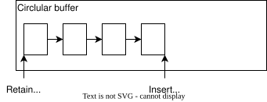
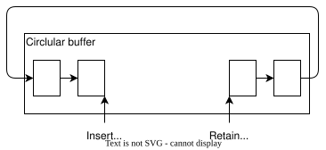
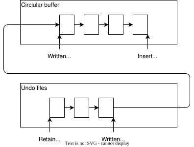
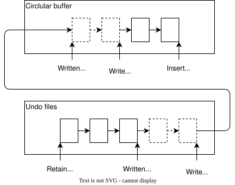
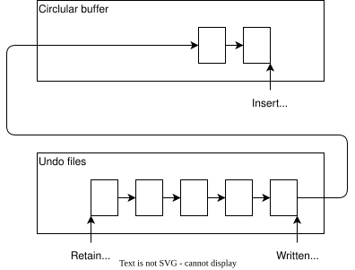

OrioleDB 可以将撤销日志存入文件，也提供内存缓冲。缓冲机制旨在让最近的撤销记录得到最快的访问。撤销缓冲区总大小由 `orioledb.undo_buffers` GUC 参数控制，一半用于环形缓冲区，另一半用于块缓冲区。

OrioleDB 保留足够多的撤销记录，以满足以下要求：

- 回滚任意进行中的事务。
- 服务所有现存快照。
- 回滚检查点期间的任意事务。

下图展示撤销环形缓冲区的填充过程。保留位置是为满足上述要求而必须保留记录的最小位置。记录之间的箭头表示插入顺序，并非实际链接。

到达环形缓冲区末尾后，如果保留位置允许在不覆盖必要记录的前提下重新使用开头空间，就从开头继续。只要需要保留的撤销记录不太多，就能把全部记录存放在环形缓冲区中。

需要添加新记录、但对应空间仍被必须保留的记录占用时，就要将一部分记录写入撤销文件。下图展示日志分布在环形缓冲区和文件中的情况：已写位置之前的记录保存在文件中，之后的记录保存在环形缓冲区中。如果不再需要保留那么多日志，例如某个长事务结束，就可以重新将全部撤销日志保存在环形缓冲区中。

下面两张图说明如何将一批撤销记录写入数据文件。首先设置“正在写入”位置，表示区间 \[已写位置；正在写入位置) 内的记录即将写入撤销文件。此期间，该区间的记录仍可从环形缓冲区读取，但不能修改；某些情况下，我们需要更新已有撤销记录。

写入完成后，推进已写位置，整个撤销日志区间重新允许读写。

