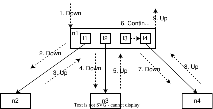
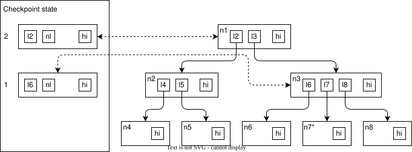
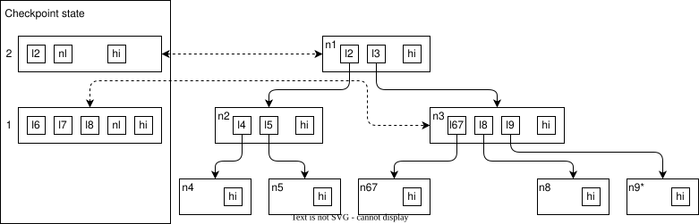

## 树的遍历顺序 {#tree-walk-order}

检查点进程按 LNR 顺序遍历 OrioleDB 树。遍历分为若干步骤，每一步产生一条消息，决定下一步操作。可能的消息如下。

1. `WalkDownwards`：上一步在内部页中找到了内存下行指针。下一步应访问更低一层的页面并开始处理。
2. `WalkUpwards`：上一步完成了页面处理。下一步应继续处理父页。
3. `WalkContinue`：释放锁后继续处理当前页。当检查点进程必须等待并发操作时，会产生此消息。

下图展示检查点进程遍历 OrioleDB B 树的例子。



检查点进程携带 `WalkDownwards` 消息到达根页 `n1`（步骤 1），检查第一个下行指针 `l1`。由于 `l1` 指向内存页，进程携带 `WalkDownwards` 到达叶子页 `n2`（步骤 2）。刷出 `n2` 后，携带 `WalkUpwards` 返回 `n1`（步骤 3），继续遍历其下行指针。接着以同样方式，经 `l2` 到达 `n3` 并返回（步骤 4、5）。`l3` 表示 I/O 正在进行，检查点进程必须解锁 `n1`，等待 I/O 完成，再以 `WalkContinue` 继续（步骤 6）。重新锁定 `n1` 后，发现 `l3` 已是磁盘下行指针，便原样复制它。最后，经 `l4` 到达 `n4` 并返回（步骤 7、8）。至此 `n1` 处理完成，进程以 `WalkUpwards` 结束遍历。

## 检查点状态 {#checkpoint-state}

检查点进程写出非叶子页的子页时，可能并发发生分裂或合并。因此，检查点状态会保存正在处理的非叶子页映像，并在访问下行指针时逐步重建。如果该非叶子页没有并发变化，最终重建状态与页面状态一致；否则，重建状态可能不对应页面在任何时刻的状态，但始终与检查点遍历树的历史相符。

重建状态不包含内存下行指针。子页写出后，内存下行指针会被对应的磁盘下行指针替换。

下图是检查点状态的一个例子。



当前正在处理根页 `n1`、内部页 `n3` 和叶子页 `n8`。下行指针 `l2` 已写入重建状态，`l3` 是重建状态中的 `next downlink`：其键已知，但对应子页尚未写出，所以指针值还未知。同样，`l6` 已写入，`l7` 是 `next downlink`，`l8` 尚未处理。

假设随后发生以下事件：

1. 检查点进程写出 `n7`。
2. `n8` 分裂为 `n8` 和 `n9`。
3. `n6` 与 `n7` 合并，结果记为 `n67`。
4. 检查点进程写出 `n8`，开始处理 `n9`。

结果如下图所示。重建的页面映像包含 `l6`、`l7`，因为访问它们时尚未合并；也包含 `l8` 以及对应 `l9` 的 `next downlink`，因为访问它们时分裂已经发生。



## 自主非叶子页 {#autonomous-non-leaf-pages}

如果正在执行检查点的非叶子页被并发修改，它会变成“自主”（autonomous）非叶子页，遵循以下规则。

1. 页面被标记为“自主”时，从它的父页到根页的所有祖先也都标记为“自主”。
2. 如果页面关联了磁盘位置，则清除关联，并将该位置在当前检查点中标记为空闲空间。
3. 持续处理自主页，直到遇到它的高键 hikey。不论为此需要访问多少页面，都必须继续；并发插入可能使页面数量很多。
4. 即使原来对应的页面发生分裂，也会跟踪持有初始高键的页面，禁止执行会移除该高键的合并。
5. 自主页已满但尚未到达对应高键时，将当前内容刷到磁盘，通过 `WalkUpwards` 将对应下行指针交给父页，然后继续处理，直到到达高键。
6. 刷出自主页时，将对应磁盘位置标记为未来检查点的空闲空间。

## 检查点消息 {#checkpointer-messages}

下面进一步说明前文列出的消息。

### WalkDownwards {#walkdownwards}

此消息包含以下参数。

- 待访问内存页的编号与变更计数。
- 低键 lokey。来自父页的下行指针；如果该指针是页内第一个，则使用父页的低键。

检查点进程必须处理引用的页面，完成后返回 `WalkUpwards`。如果该页是非叶子页，处理期间会产生更多消息，但最后必须返回该页的 `WalkUpwards`。

并发操作可能导致失败，例如内存页的变更计数已经不同。此时，对应的 `WalkUpwards` 应返回无效下行指针。失败时，`WalkUpwards` 必须紧接 `WalkDownwards` 返回：一旦开始处理非叶子页，就必须将其处理完。

### WalkUpwards {#walkupwards}

此消息包含以下参数。

- 磁盘下行指针。如前所述，它可能无效。
- 下一个键，实际就是刚写出页面的高键。由于并发分裂或合并，它可能与父页的后续下行指针不匹配；不匹配时，必须将父页标记为“自主”。
- 表示父页必须标记为“脏”的标志。如果页面在上一次检查点之后写到了新位置，就设置该标志；如果之后页面及其子页未被修改，则不设置。父页必须标脏并写出，才能反映新的磁盘下行指针。
- 表示必须保留父页现有 `next downlink` 的标志。自主页的当前重建映像完成时会出现这种情况：页面已写出，需要向父页插入新下行指针，但仍需继续访问同一个 `next downlink`。

此消息表示子页已经处理，父页需要添加其下行指针。如果没有父页，则意味着根页已处理完成，此时得到新根页的磁盘位置指针。

### WalkContinue {#walkcontinue}

此消息没有参数，表示检查点进程必须使用同一个 `next downlink` 继续处理同一页面。需要等待并发操作时就会产生此消息，例如遇到正在执行 I/O 的下行指针，必须先释放锁并等待 I/O 完成。

## 顺序缓冲区 {#sequential-buffers}

### 什么是顺序缓冲区？ {#what-are-sequential-buffers}

顺序缓冲区（seq bufs）是一种轻量级、基于文件的流式 I/O 抽象，供检查点进程和写 B 树页的普通后端使用。它不将全部检查点元数据放在共享内存中，而是用两个内存中的 OrioleDB 页面作为双缓冲，在磁盘文件之间流式读写。一页由调用者填充或消耗时，另一页可在后台刷盘或预取，因此无需占用大量共享内存也能获得顺序访问吞吐量。

每个顺序缓冲区由 `SeqBufTag` 标识，即 `(datoid, relnode, checkpointNumber, type)` 元组。`type` 区分两类文件：

- **`'m'`（映射文件）**：记录磁盘页面位置的检查点映射。
- **`'t'`（临时文件）**：检查点遍历期间使用的临时跟踪文件。

检查点进程与写入后端需要共享的内存状态位于 `SeqBufDescShared`，它直接嵌入 B 树元数据页 `BTreeMetaPage`。打开的文件描述符等后端私有状态位于 `SeqBufDescPrivate`，存放在树描述符 `BTreeDescr` 中，每个后端各自持有。

### 为什么使用顺序缓冲区？ {#why-are-sequential-buffers-used}

每棵可执行检查点的 B 树保留三组顺序缓冲区。

1. **`freeBuf`**：进入新检查点时，检查点进程打开此缓冲区，*读取*上一次检查点记录的空闲磁盘区段列表。当前检查点写页面时可以复用这些区段，避免文件不必要地增长。每棵树只有一个 `freeBuf`，不采用双槽数组，因为每次检查点开始时会原子替换它：先放好新文件，再移除旧文件。

2. **`nextChkp[2]`**：检查点进程打开两个槽中的一个，*写入*当前检查点的映射文件。每次 B 树页面刷盘，其位置都会追加到映射中。下一次检查点通过 `freeBuf` 读取此映射，无需重新遍历整棵树即可知道页面位置。

3. **`tmpBuf[2]`**：检查点进程打开其中一个槽，*写入*临时文件，跟踪遍历期间写出的每个页面。遍历结束后，对文件排序、去重，再据此执行打洞，回收数据文件中的未使用空间。检查点完成后删除该文件。

### 为什么有两个槽，即 `[2]` 数组？ {#why-are-there-two-slots-the-2-arrays}

OrioleDB 检查点与普通 DML 并发运行。为了避免检查点 N 与检查点 N+1 的初始化串行执行，`nextChkp`、`tmpBuf`、`datafileLength`、`partsInfo` 等数组都使用 `checkpointNumber % 2` 作为下标。

任一时刻恰好有一个槽处于活动状态，由正在执行的检查点写入；另一个槽要么仍保存上一次检查点的数据，在新检查点验证前供恢复使用，要么空闲。

```
Checkpoint N   → uses slot  N % 2
Checkpoint N+1 → uses slot (N+1) % 2   (the other slot)
```

这种交替使用方式让检查点 N+1 可以在检查点 N 尚在收尾时开始分配页面并初始化顺序缓冲区文件，而不会发生共享状态冲突。

元数据页上的两个脏标志 `dirtyFlag1`、`dirtyFlag2` 也支持这一机制。`dirtyFlag1` 在检查点开始时清除；`dirtyFlag2` 提供额外一代状态，确保与清除 `dirtyFlag1` 并发发生的修改不会悄然丢失。如果检查点即将处理一棵树时两个标志均为 false，说明该树自上次检查点后没有变化，刚初始化的顺序缓冲区文件会立即关闭并删除，不写入任何数据。

### 何时移除顺序缓冲区？ {#when-are-sequential-buffers-removed}

顺序缓冲区结束使用时，**内存页面**立即归还页面池，具体包括：

- **检查点成功完成**：`tmpBuf` 页面在后处理结束后释放；`nextChkp` 页面在映射文件头写入并完成重命名后释放。
- **树描述符被逐出**：描述符缓存回收树描述符时，`btree_finalize_private_seq_bufs()` 会刷出并释放其活动顺序缓冲区的全部内存页。
- **树被删除**：`checkpointable_tree_free()` 关闭所有顺序缓冲区文件描述符，释放操作系统资源。

顺序缓冲区的**磁盘文件**寿命比内存页更长：

- **临时文件**（`'t'`）在创建它的检查点完成后处理后删除。
- 检查点 N 的**映射文件**（`'m'`）保留到检查点 N+1 完成且新的映射文件就绪，确保时间点恢复始终能找到最近一次干净的检查点。
- **空闲区段文件**采用原子替换：先写出新文件并重命名到位，再删除旧文件。
- 如果树在两次检查点之间**未被修改**，即两个脏标志均为 false，则为本次检查点初始化的顺序缓冲区文件立即关闭并删除，不写入任何数据。
