## Page change count {#page-change-count}

In OrioleDB B-tree, we do not lock pages unless we need to modify them. Therefore, after traversing the downlink, we need to check if we reach the target page (because it could be concurrently evicted, merged, etc.). In order to cope with that, OrioleDB each in-memory page has `OrioleDBPageHeader.pageChangeCount` field, which got incremented every time the in-memory page changes its identity. The in-memory page identity means a particular tree, level, and lokey (left bound of the page key range). Despite the page lokey is not stored at the page, it is structurally determined. Therefore left page of split and the left page of merge save identities. Thanks to the change count mechanism, the process traversing the downlink can detect a concurrent change of the page identity.

## Rightlinks {#rightlinks}

In OrioleDB, in-memory downlinks can be changed to on-disk downlinks and vice versa on page eviction and load correspondingly. Therefore, OrioleDB pages do not normally have rightlinks or leftlinks. Rightlinks temporarily exist during split to prevent blocking tree navigation. Consider the page split process in the pictures below.

Step 1 depicts the initial state of part of the tree comprising parent page 1 and child page 2.

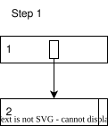

Step 2 depicts the split of page 2, creating the new page 3. At this point, page 2 has a rightlink to page 3. At this point, if a concurrent process is looking for the key located on page 3, it will check the hikey of page 2 and traverse to page 3 via rightlink. The keys located on page 2 could be found as usual.

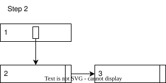

Step 3 depicts the insertion of the new downlink to page 1. The rightlink between pages 2 and 3 still persists. At this point, the concurrent process can locate page 3 via downlink. If the concurrent process came to page 2 before downlink insertion, it still could use the rightlink.

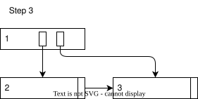

Step 4 depicts the removal of the rightlink from page 2 to page 3. If a concurrent process, which came to page 2 before downlink insertion, is looking for a key located on page 3, then it has to check the rightlink and restart from page 1.

## Page eviction {#page-eviction}

Page eviction is forbidden for the page with a rightlink or without a downlink from the parent. Generally, both source and target of rightlink are forbidden. Therefore page eviction does not have to deal with rightlinks. Rightlinks can connect only in-memory pages. Consider the page eviction process in the pictures below.

Step 1 depicts the initial state of part of the tree comprising parent page 1 and child page 2. Page 2 is locked and should be evicted. At this point evicting process should find and lock the parent page 1 using the page 2 hikey to find it.

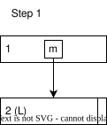

Step 2 depicts both page 1 and page 2 locked. At this point evicting process repaces in-memory downlink with IO downlink and increases page change count. IO downlink prevents a concurrent process from using it, making them wait till IO is completed. Increased change count prevents all the concurrent processes, which managed to use in-memory downlink, from using page 2.

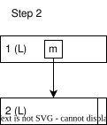

Step 3 depicts page 1 disconnected from its child with IO downlink.

Finally evicting process writes the on-disk downlink to page 1 (step 4).

## Page load {#page-load}

When Postgres backend needs a page referenced by the on-disk downlink on OrioleDB non-leaf page, it has to load that page.

Step 1 depicts the initial state of the non-leaf page 1 before loading its child. Page 1 is locked and has an on-disk downlink. At this point, the process needs to replace the downlink with IO in-progress one, unlock page 1 and start the IO.

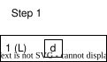

Step 2 depicts the page 1 state while the IO is in progress. All the concurrent processes dealing with that downlink must wait until IO is completed. When the IO is completed, our process needs to relock page 1.

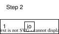

Step 3 depicts the state when page 1 is relocked. At this point, our process needs to add child page 2 and make the downlink on page 1 point to page 2.

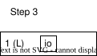

Step 4 represents the final state. Page 2 is loaded, and page 1 contains the in-memory downlink to page 2.

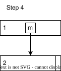

## Page merge {#page-merge}

When OrioleDB has a page candidate for eviction, and that page is too sparse (with less than 30% of space busy), it considers page merging. Page merging will also free an in-memory page but does not need an IO, even for a dirty page.

Step 1 depicts the initial state of part of the tree comprising parent page 1, child page to be merged 3 (locked), left sibling 2, and right sibling 4. At this point, we need to lock the parent page 1. We release child page 3 lock first.

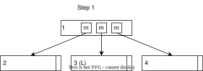

Step 2 depicts the state where parent page 1 is locked, but the child is not. At this point, we need to relock the child page 3 to be merged. If this page is gone (due to concurrent eviction or another merge), then give up with merging. We also check that parent is not under checkpoint and give up otherwise.

Step 3 depicts both parent page 1 and child page 3 locked. Here we need to select the way to merge. We check that child page 3 is not under checkpoint and does not have a rightlink. Give up otherwise.

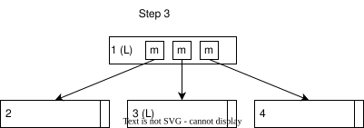

Step 4 depicts two possible ways to merge: with right sibling 4 (upper picture) or with left sibling 3 (upper picture). Note that the left page always saves its identity in either direction we chose. So if we merge to the left, page 3 will be removed. We cannot merge with a sibling under checkpoint or have a rightlink.

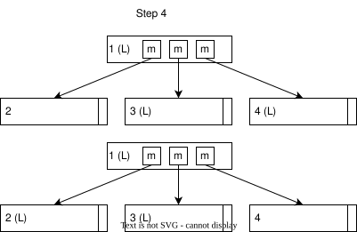

Step 5 depicts the merge result. In this example, we merged to the right. All the tuples on page 4 were merged into page 3. The result page is marked as page 34. Page 34 also has a hikey of page 4. Also, we remove page 4 and the corresponding downlink on page 1.

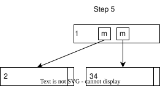
