## 页面变更计数 {#page-change-count}

OrioleDB B 树只在需要修改页面时加锁。因此，沿下行指针前进后，必须检查是否到达了目标页，因为该页可能已经被并发逐出、合并等。为此，每个内存页都带有 `OrioleDBPageHeader.pageChangeCount` 字段，页面身份每次变化时都会递增。内存页身份由所属树、层级和低键 lokey（页面键范围的左边界）决定。虽然低键不直接存储在页中，但由树结构确定。因此，分裂后的左页和合并后的左页都保留原有身份。通过变更计数，沿下行指针遍历的进程能够检测页面身份的并发变化。

## 右向链接 {#rightlinks}

OrioleDB 逐出页面时，内存下行指针会变为磁盘下行指针；载入页面时则相反。因此，页面通常没有左右链接。右向链接只在分裂期间临时存在，以免阻塞树遍历。下面展示页面分裂过程。

步骤 1 是初始状态：树的这一部分由父页 1 和子页 2 组成。

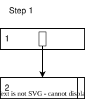

步骤 2 将页面 2 分裂，创建页面 3。此时页面 2 有一个指向页面 3 的右向链接。并发进程若查找的键位于页面 3，会检查页面 2 的高键，然后沿右向链接到达页面 3。页面 2 中的键仍可照常查找。

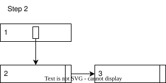

步骤 3 向页面 1 插入新的下行指针，页面 2 与 3 之间的右向链接仍保留。此时并发进程可以通过下行指针定位页面 3。如果进程在插入下行指针之前就到达了页面 2，仍可使用右向链接。

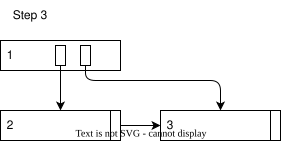

步骤 4 移除从页面 2 到页面 3 的右向链接。如果某并发进程在下行指针插入前到达页面 2，却要寻找页面 3 中的键，那么检查右向链接后，就必须从页面 1 重新开始。

## 页面逐出 {#page-eviction}

带有右向链接，或还没有父页下行指针指向它的页面，不能被逐出。通常，右向链接的起点和终点都禁止逐出。因此，逐出过程不必处理右向链接，右向链接也只能连接内存页。下面展示逐出过程。

步骤 1 是父页 1 和子页 2 的初始状态。页面 2 已加锁，准备逐出。逐出进程应利用页面 2 的高键找到父页 1，并将其锁定。

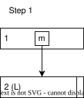

步骤 2 中，页面 1 和页面 2 均已锁定。逐出进程将内存下行指针替换为 I/O 下行指针，并递增页面变更计数。I/O 下行指针会阻止并发进程继续使用它，让它们等待 I/O 完成；增大的变更计数则阻止那些已经沿原内存下行指针前进的进程继续使用页面 2。

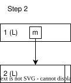

步骤 3 中，页面 1 通过 I/O 下行指针与其子页断开连接。

最后，逐出进程将磁盘下行指针写入页面 1，即步骤 4。

## 页面载入 {#page-load}

PostgreSQL 后端需要访问非叶子页中磁盘下行指针所引用的页面时，必须先载入该页。

步骤 1 展示载入子页前非叶子页 1 的状态。页面 1 已加锁，并包含磁盘下行指针。此时进程需将其替换为表示 I/O 正在进行的指针，解锁页面 1，再启动 I/O。

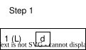

步骤 2 展示 I/O 期间页面 1 的状态。访问该下行指针的所有并发进程都必须等待 I/O 完成。完成后，本进程重新锁定页面 1。

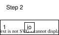

步骤 3 中，页面 1 已重新锁定。此时添加子页 2，并让页面 1 中的下行指针指向它。

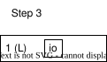

步骤 4 是最终状态：页面 2 已载入，页面 1 中有指向页面 2 的内存下行指针。

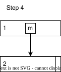

## 页面合并 {#page-merge}

如果待逐出的候选页过于稀疏，已用空间低于 30%，OrioleDB 会考虑合并页面。合并同样可以释放一个内存页，但即使页面为脏页，也不需要 I/O。

步骤 1 展示初始状态：父页 1、已锁定的待合并子页 3、左兄弟页 2 和右兄弟页 4。此时需要锁定父页 1，因此先释放子页 3 的锁。

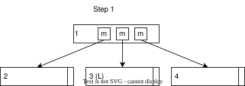

步骤 2 中，父页 1 已锁定，子页尚未锁定。需要重新锁定待合并的子页 3。如果该页已因并发逐出或其他合并而消失，就放弃此次合并。同时检查父页是否正在执行检查点；如果是，也放弃。

步骤 3 中，父页 1 与子页 3 均已锁定，需要选择合并方向。先检查子页 3 是否正在执行检查点或带有右向链接；只要满足任一条件，就放弃合并。

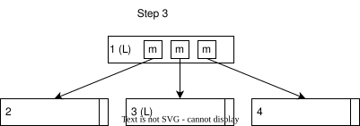

步骤 4 展示两种方向：与右兄弟页合并，或与左兄弟页合并。无论选择哪边，左页始终保留身份，因此向左合并时，页面 3 会被移除。不能与正在执行检查点或带有右向链接的兄弟页合并。

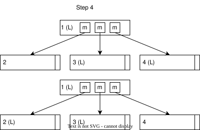

步骤 5 展示合并结果。本例向右合并，将页面 4 的所有元组并入页面 3，结果记为页面 34。页面 34 继承页面 4 的高键，同时删除页面 4 及其在页面 1 中的下行指针。

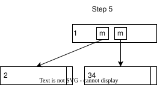
