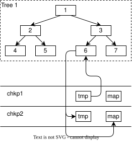
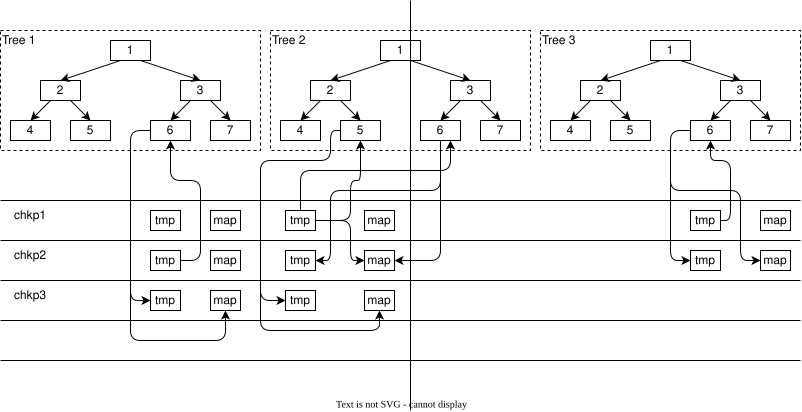

OrioleDB 结合元数据文件、检查点和系统树，为普通树和压缩树高效分配并跟踪空闲块与区段。

## 普通树 {#regular-trees}

每棵 OrioleDB 树都有对应的数据文件，其长度记录在 `BTreeMetaPage.datafileLength` 中，但不一定与实际文件长度严格一致。实际文件可能更短，表示某些页面只分配了逻辑偏移量，尚未写入；也可能更长，表示上次数据库运行在崩溃前曾写到更远的位置，而这些位置现在应视为空闲空间。

每棵树的每次检查点都有两个用于空闲空间管理的文件。

- `*.tmp` 保存上次检查点完成至本次检查点完成之间释放的块编号。如果期间没有释放块，此文件可以不存在。
- `*.map` 包含：
  - 树根的链接。
  - 检查点完成时的数据文件长度。
  - 该检查点中的空闲块编号数组。

因此，树根以及从根直接或间接引用的全部块，都视为该检查点中的已用块。文件长度范围内的其他块视为空闲块，应列入空闲块数组。

OrioleDB 写页面需要分配块时，按以下顺序获取：

- 数据库实例启动时所用检查点的 `*.map` 文件中的空闲块数组。
- 后续已完成检查点的 `*.tmp` 文件，如果存在。
- 增长数据文件长度，即原子递增 `BTreeMetaPage.datafileLength`。

下图展示没有并发检查点时的页面写出。

如果待写页已关联数据文件中的某个块，就将旧块编号写入下一次检查点的 `*.tmp` 和 `*.map` 文件。图中，旧块编号写入检查点 2 的这两个文件。

新块按前述规则分配。图中从检查点 1 的 `*.tmp` 文件获取新块。

下图进一步展示页面写出与检查点进度的关系。

图中检查点 1 已完成，检查点 2 正在进行。检查点进程按确定的顺序处理各棵树。

对于已被遍历完的树，正在进行的检查点视为已完成。图中的树 1 已处理完，因此视检查点 2 为已完成、检查点 3 为未来检查点。

对于尚未到达的树，正在进行的检查点等同于尚未开始。图中的树 3 尚未处理，因此视检查点 1 为已完成、检查点 2 为未来检查点。

正在处理的树最复杂。其部分内容已经写出，若再次写这些部分，就不能原地覆盖，否则违反写时复制原则，而必须写到新位置，归入当前检查点之后的下一次检查点。因此，从左向右遍历时，处理逻辑取决于检查点是否已经经过该页。

- 如果待写页已被遍历，且已关联数据文件中的块，就将旧块编号写入当前检查点之后那次检查点的 `*.tmp` 和 `*.map` 文件。图中，树 2 的页面 5 的旧块编号写入检查点 3 的这两个文件。

- 如果待写页已被遍历，新块仍按前述规则分配。当前检查点尚未完成该树，因此不能从它的 `*.tmp` 文件获取块。分配新块后，还必须将其写入当前检查点的 `*.map`，因为该块属于下一次检查点，对当前检查点而言是空闲的。图中，树 2 的页面 5 从检查点 1 的 `*.tmp` 分配新块，同时将编号写入检查点 2 的 `*.map`。

- 如果待写页尚未被遍历，处理方式与尚未到达的树类似。检查点进程自己写页也遵循同样规则：如果已有数据文件块，将旧块编号写入当前检查点的 `*.tmp` 和 `*.map`。图中，树 2 的页面 6 的旧块编号写入检查点 2 的这两个文件；新块按前述规则分配，图中来自检查点 1 的 `*.tmp`。

完成某棵树的检查点后，需要收尾其 `*.map` 文件：将按规则可用的 `*.map` 和 `*.tmp` 中全部空闲块加入该文件，并把当前 `BTreeMetaPage.datafileLength` 写为文件长度。

## 压缩树 {#compressed-trees}

OrioleDB 实现了页级压缩。页面在内存中长度固定，在数据文件中长度可变，因此前述空闲空间机制需要扩展。

首先，`*.tmp` 和 `*.map` 保存的不再是空闲块编号，而是由偏移量和长度组成的空闲区段。

处理区段时，仅顺序读取 `*.tmp` 和 `*.map` 不足以满足需求，因为遇到的区段长度可能不合适。为此还使用两棵系统树：`SYS_TREES_EXTENTS_OFF_LEN` 和 `SYS_TREES_EXTENTS_LEN_OFF`。后者按区段长度排序，用来寻找最合适的区段；前者按偏移量排序，用于合并相邻区段。

这两棵树是临时的，重启后内容不会保留，服务器启动时始终为空。载入某棵树时，也将其 `*.map` 内容载入这两棵系统树。树的检查点完成时，读取上一次检查点的 `*.tmp` 内容到系统树中；检查点完成时，再把系统树中的区段加入 `*.map`。

多个进程可能同时寻找空闲区段，并有一个进程插入新的空闲区段。正确处理并发并不容易，算法如下。

为页面写出获取空闲区段：

1. 在 `SYS_TREES_EXTENTS_LEN_OFF` 中找到能容纳页面的最短区段并删除。如果找不到，就按所需长度增长 `BTreeMetaPage.datafileLength`，返回对应区段。
2. 如果选中区段还有剩余，将剩余部分插入 `SYS_TREES_EXTENTS_OFF_LEN`。
3. 从 `SYS_TREES_EXTENTS_OFF_LEN` 删除原选中区段。
4. 如果存在剩余部分，将其插入 `SYS_TREES_EXTENTS_LEN_OFF`。

如果并发进程需要合并剩余部分，它始终能找到可合并的区段。这是因为在 `SYS_TREES_EXTENTS_OFF_LEN` 中先插入（步骤 2）、再删除（步骤 3），不会出现无区段可合并的中间状态。

插入新空闲区段的算法：

1. 在 `SYS_TREES_EXTENTS_OFF_LEN` 中找到新区段的左右兄弟，检查是否相邻并需要合并。
2. 如需合并左兄弟，先将其从 `SYS_TREES_EXTENTS_LEN_OFF` 删除。失败则返回步骤 1 重试。
3. 如需合并右兄弟，先将其从 `SYS_TREES_EXTENTS_LEN_OFF` 删除。失败则重新插入此前删除的左兄弟，再返回步骤 1。
4. 此时左右兄弟都已从 `SYS_TREES_EXTENTS_LEN_OFF` 删除，并发进程无法再使用它们。
5. 从 `SYS_TREES_EXTENTS_OFF_LEN` 删除待合并的兄弟区段。
6. 将合并后的新区段先插入 `SYS_TREES_EXTENTS_OFF_LEN`，再插入 `SYS_TREES_EXTENTS_LEN_OFF`。
