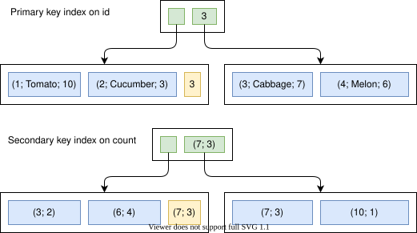
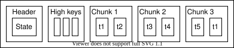
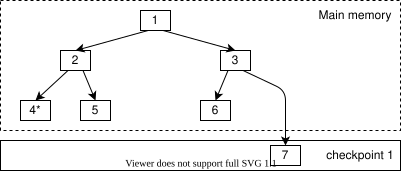
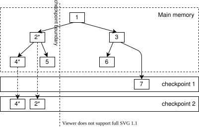
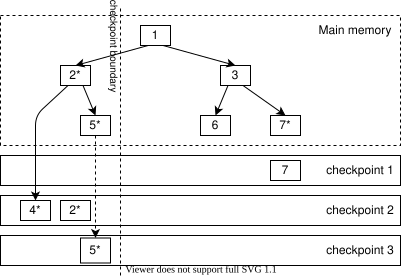
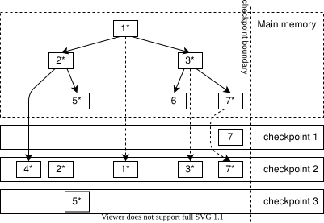
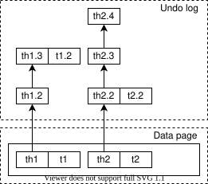
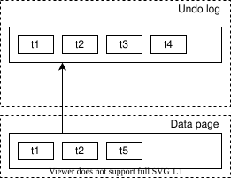

OrioleDB 使用索引组织表来组织数据，通过双重指针高效管理内存，并采用新的页面结构、写时复制检查点、撤销日志和行级 WAL，实现可靠的事务管理与恢复。它还通过系统目录和数据压缩优化运行。

## 索引 {#indexes}

OrioleDB 将数据存储在索引组织表中。以 `vegetables` 表为例：它在 `id` 上有主键索引，在 `count` 上有二级索引。

| Id | Name | Count |
|-----|----------|-------|
| 1 | Tomato | 10 |
| 2 | Cucumber | 3 |
| 3 | Cabbage | 7 |
| 4 | Melon | 6 |
{.wide .expand}

下图展示 `vegetables` 表背后的数据结构。主键索引和二级索引都是 B+ 树的变体。叶子元组为蓝色，非叶子元组为绿色，高键为黄色。主键索引的非叶子元组和高键由主键列组成，叶子元组就是表行本身。二级索引的非叶子元组、叶子元组和高键都包含二级索引列与主键列。

主键索引和二级索引并不直接绑定，只通过表行中持久保存的逻辑值关联。如果未指定主键，OrioleDB 会在虚拟 `ctid` 列上自动创建主键索引。

## 双重指针 {#dual-pointers}

OrioleDB 使用“双重指针”（dual pointers）方案来避免缓冲区映射及其瓶颈。其思路是：内存中非叶子页的下行指针既可以指向内存页，也可以指向存储页。因此，遍历内存页时可以直接沿链接前进，无需缓冲区映射表。如果要沿指向存储页的下行指针继续遍历，就必须先把存储页载入内存，再将该下行指针替换为内存指针。

下图是 OrioleDB B 树的简化结构。图中未展示页内细节，内存页使用与其对应存储页相同的编号，箭头表示下行指针。

内存页可以引用内存页和存储页，但存储页只能引用存储页。因此，图中内存页与存储页 `1`、`2`、`3` 虽然编号相同，内容在上述方面却并不一致。

为了实现这一方案，我们必须放弃常驻的右向链接。在内存指针与存储指针之间切换下行指针和右向链接，会过于复杂，也可能太慢。

严格来说，OrioleDB B 树仍包含右向链接，但只在页面分裂时临时使用：它仅存在于新页分裂出来到其下行指针插入父页之间。如果在定位树页的同时完成了分裂，就必须从父页重试，参见 `find_page()`。向左、向右移动也更复杂：不能通过左右链接直接移动，而必须从父页寻找兄弟页，参见 `find_right_page()` 和 `find_left_page()`。不过，更好的纵向扩展性足以抵偿这些复杂性。

详见 [OrioleDB B 树的并发算法](/zh/orioledb/architecture/concurrency/)。

## 页面结构 {#page-structure}

OrioleDB 实现了面向现代多核机器优化的新页面结构。

页头包含一个 `state` 原子变量，提供以下功能：

1. 页面排他锁。同一时刻只能有一个排他锁持有者。单独持有此锁并不赋予修改页面内容的权限，也不会阻止其他进程读取页面。
2. 排他锁持有者可以升级锁以阻止页面读取。阻止读取后，才可以开始修改页面内容。
3. 跟踪页面内容的变更计数。因此，进程可以复制部分页面或进行一些计算，然后检查页面是否被并发修改；如果是，则重试。

详见 `src/btree/page_state.c`。

页中的元组被划分为多个块，并有一个高键区域，每个块对应一个高键。最后一个块的高键也是页面的高键。因此，查找页中特定元组时无需复制整页，只需复制高键区域、找到对应块，再复制该块。`PartialPageState` 结构负责跟踪部分读取的页面。

未来我们计划在大多数页面访问模式下消除复制，并使用向量化加快页内搜索。

## 写时复制检查点 {#copy-on-write-checkpoints}

OrioleDB 使用写时复制检查点和行级 WAL。下面的例子说明写时复制检查点的基本过程。

假设页面 `7` 被修改，记为 `7*`。

检查点按照写时复制原则，将 `7*` 写入存储中的空闲位置。写非叶子页时，会把内存下行指针替换为存储指针。因此页面 `3` 也被视为已修改，因为存储页需要引用新的 `7*`。于是 `3*` 也写入新的空闲位置，`1*` 同理。

检查点完成后，旧的存储页映像 `1`、`3`、`7` 被标记为空闲空间。

因此，存储中始终存在一致的树映像。

OrioleDB 支持模糊检查点，即允许检查点与树修改并发进行。这很重要，因为执行过快或过于频繁的检查点可能造成写入洪峰。

考虑下面的例子。树包含页面 `1`～`7`，页面 `1`～`6` 同时存在于内存和存储中（检查点 1），页面 `7` 只在存储中。页面 `4` 已被修改，记为 `4*`。

检查点从左向右遍历树，已经经过由页面 `2`、`4`、`5` 组成的子树。页面映像 `4*` 和 `2*` 被写入检查点 2。

与此同时，页面 `5` 被修改为 `5*`，后台写进程写出了 `5*`。页面 `5` 属于检查点已经处理过的部分，因此不能写入检查点 2，否则会破坏其一致性。

页面 `7` 也被并发修改，但尚未由后台写进程写出。

随后，检查点将页面映像 `7*`、`3*`、`1*` 写入检查点 2，完成处理。

实际的非叶子页检查点比上述过程更复杂。检查点写出子页时，可能并发发生分裂和合并，此时必须根据遍历时遇到的子页状态重建非叶子页。因此，写入存储的非叶子页映像可能从未在内存中存在过，甚至一个内存页可能对应多个存储页。可以设想，检查点边界上方发生合并，而下方发生分裂。这并无问题，因为写出的页反映了检查点实际写出子页的方式。

任一时刻都可能存在多个检查点，它们使用不同但相互重叠的块集合，因此[空闲空间管理](/zh/orioledb/architecture/fsm/)并不简单。

详见[检查点算法](/zh/orioledb/architecture/checkpoints/)。

## 撤销日志 {#undo-log}

OrioleDB 通过撤销日志实现事务和 MVCC。行级撤销记录构成行版本链：元组头串成链表，链头位于数据页，其余节点位于撤销日志中，如下图所示。

有些撤销记录同时包含元组头和元组体，如更新记录；有些不修改元组体，只包含元组头，如删除记录和行级锁记录。

撤销记录既位于行版本链中，也位于事务链中。事务中止时，系统遍历对应事务链，重放全部撤销记录。

检查点期间会写出撤销日志快照，因为恢复时可能需要回滚检查点期间尚未结束的事务。除检查点之外，只要对应共享内存容得下，就不必将撤销日志写入存储。

有时只需重放事务链的一部分。例如，OrioleDB 的 `ROLLBACK TO SAVEPOINT` 会将事务撤销链重放到指定位置，`INSERT ... ON CONFLICT ...` 中撤销推测插入的方式也相同。但重放了部分撤销链之后，恢复时仍可能需要它，因为对应数据可能在重放前已被部分写入检查点。为跟踪这种情况，我们加入特殊的 `branch` 撤销记录，使恢复过程能够遍历已经重放过的分支。

有些撤销记录还要求在提交时执行操作。例如，`TRUNCATE` 的实现会生成一条撤销记录：事务提交时删除旧 relfilenode，事务中止时删除新 relfilenode。需要提交时操作的撤销记录由单独的链表跟踪。

OrioleDB 还支持块级撤销记录，用于记录作用于整个页面的修改。

下图展示一个 `compact` 块级撤销记录。数据页包含元组 `t1`、`t2`、`t5`，而撤销日志中的页映像包含 `t1`、`t2`、`t3`、`t4`。这表示删除 `t3` 和 `t4` 后，仍没有足够空间容纳新元组 `t5`，因此先执行页面整理：生成页级撤销记录，再清除 `t3` 和 `t4`，为 `t5` 腾出空间。

OrioleDB 有三种块级撤销记录：

1. 整理撤销记录：一个数据页引用一个撤销页映像。
2. 分裂撤销记录：两个数据页引用一个撤销页映像。
3. 合并撤销记录：一个数据页引用两个撤销页映像。

OrioleDB 同时使用环形缓冲区和块缓冲区访问撤销日志，详见[撤销日志存储](/zh/orioledb/architecture/buffering/)。

## 行级 WAL {#row-level-wal}

OrioleDB 实现了用于恢复和复制的行级预写日志（WAL），它要求前文所述的结构一致检查点。行级 WAL 记录包括事务开始、插入行、更新行、删除行、事务提交或中止等。完整记录类型见 `include/recovery/wal.h`。

OrioleDB 表的数据包含以下 B 树：

1. TOAST 树。
2. 主键树。
3. 二级索引树。

TOAST 树和主键树写入 WAL，二级索引树则不写。二级索引根据 TOAST 和主键的变更恢复。

由于 OrioleDB 使用模糊检查点，这里需要幂等性。检查点先访问 TOAST 树和主键树，再访问二级索引树，因此检查点中的二级索引状态可能比前两者更新。幂等性确保某些变更即使向二级索引应用两次或更多次，也不会影响最终状态。

OrioleDB 支持并行应用 WAL 记录，启动 `orioledb.recovery_pool_size` 个工作进程。每个进程根据哈希值负责一组主键值，启动进程将行级 WAL 记录分发到各工作进程的队列。

各队列处理速度可能不同。为了避免 MVCC 异常，只有所有工作进程都完成某个事务的全部相关工作后，才认为该事务已经提交，并对读者可见。

详见 [OrioleDB 恢复机制](/zh/orioledb/architecture/recovery/)。

## 系统目录 {#system-catalog}

OrioleDB 的检查点、页面写出与逐出以及恢复操作，都是在逻辑层面操作树。因此，它们必须能够比较元组键、计算元组长度等，需要访问相应元信息。但这些操作又必须能够在尚未完全初始化 PostgreSQL 数据库连接时进行。

为解决这个问题，OrioleDB 实现了“系统树”，相当于自己的系统目录，只包含执行上述操作所必需的最少信息，包括表、关联的树、数据类型等。详见 `src/catalog/sys_trees.c`。

## 数据压缩 {#data-compression}

OrioleDB 支持块级数据压缩。压缩树中的存储页使用 `zstd` 算法压缩，因此长度可变，需要更复杂的空闲空间管理机制。

OrioleDB 使用两棵系统树管理这些空间：`SYS_TREES_EXTENTS_OFF_LEN` 和 `SYS_TREES_EXTENTS_LEN_OFF`。两者都记录空闲区段；前者按偏移量排序，后者先按长度、再按偏移量排序。后者用来为新存储块寻找最合适的空闲区段，前者用来寻找相邻区段并将它们合并。
