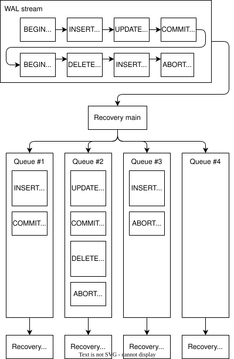
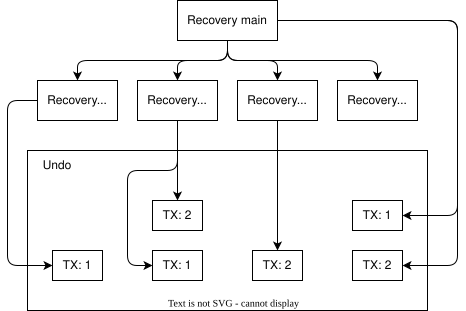
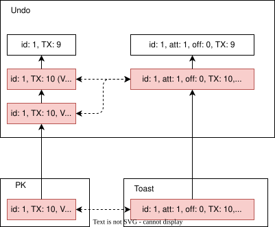
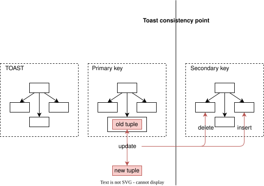

OrioleDB 将恢复工作分配给多个工作进程，每个进程负责一组主键值。大事务由多个进程共同处理，从而实现高效、可扩展的恢复与复制。

## 在多个进程之间分配工作 {#splitting-work-between-multiple-processes}

OrioleDB 实现了多进程恢复与复制。从技术上看，PostgreSQL 复制就是允许并发只读查询的网络恢复。主恢复进程读取 WAL 流，并通过队列将消息分发给恢复工作进程。

与其他方案不同，我们不按事务分配工作，而是让每个工作进程负责各表的一组键，即主键值。因此，一个大事务会拆成若干部分交给不同工作进程。这种方式的主要优势是：恢复与复制的扩展能力不再依赖事务本身的并行度。

下图展示一个主恢复进程和四个恢复工作进程。示例 DML 针对同一张表，其主键为整数类型的 `id` 列。WAL 流中的事务 1 包含插入 `id = 1` 和更新 `id = 2`，事务 2 包含删除 `id = 2` 和插入 `id = 3`。主恢复进程按 `id` 的哈希值分发操作：`id = 1` 进入队列 1，`id = 2` 进入队列 2，`id = 3` 进入队列 3。

主进程不会分发事务开始消息，因为此时还不知道哪些工作进程会参与事务。它会将事务 ID 附加到行修改消息中。另外，OrioleDB 事务在 WAL 中不一定连续，不同事务的记录可以交错出现。

主恢复进程跟踪每个事务有哪些工作进程参与。当 WAL 流确认事务提交或中止时，主进程将该消息发送给参与者。

恢复工作进程不会在每次事务结束时同步。因此，工作进程 #2 可以在工作进程 #2 完成 `commit` 消息之前处理 `delete` 消息。这是因为各工作进程分别维护自己所知的已结束事务状态。

恢复进程在 `recovery_xid_state_hash` 中保存恢复事务状态。需要确定事务状态时，先检查这个哈希表，再检查共享内存。只有所有工作进程都处理了事务结束消息，主恢复进程才更新共享内存中的事务状态。共享状态更新后，工作进程便可从哈希表中移除对应条目。

恢复时，一个事务实际上被拆到主进程和多个工作进程中，其撤销日志也相应拆分，如下图所示。事务在主进程中可能有一条撤销链，包含检查点期间已存在的事务撤销记录，以及主恢复进程重放操作（如 DDL）的撤销记录。同时，该事务在恢复工作进程中也可能有一条或多条撤销链。

## 主键、TOAST 与二级索引 {#primary-keys-toast-and-secondary-indexes}

恢复必须让表的所有树达到一致状态，包括主键、TOAST 和二级索引。主键与 TOAST 是基础信息，二级索引可以从中推导，因此 OrioleDB WAL 只记录主键树和 TOAST 树的变更。

OrioleDB TOAST 树的键包含：

1. 主键值。
2. TOAST 值对应的属性编号。
3. 该 TOAST 值内部的偏移量。

因此，一个值由 TOAST 树中一个或多个偏移量不同的叶子元组表示，偏移量从零开始。

同一事务中可能存在同一元组的多个版本。如果 TOAST 值也被更新，就会相应存在多个版本。因此，必须将主键元组版本与 TOAST 元组版本正确匹配。为此，我们在元组中附加版本号，如下图所示。

版本号以事务为单位，每个新事务都从零开始。零是默认版本；元组未携带版本号时，其版本就是零。属于进行中事务的主键元组在同一事务内再次更新时，版本号递增。被更新的 TOAST 字段，其 TOAST 元组会获得与新主键元组相同的版本号。因此，查找给定主键元组对应的 TOAST 元组时，应选择版本号不大于主键元组版本号的最大版本。

OrioleDB 必须根据 TOAST 树和主键树恢复二级索引。二级索引可能建在 TOAST 字段上，使问题更加复杂。

因此，OrioleDB 按以下顺序写检查点：

1. TOAST 树。
2. 主键树。
3. 二级索引树。

写入 WAL 时，也先写 TOAST 元组，再写主键元组。

主键树的检查点完成时，将当前 WAL 位置标记为“TOAST 一致性点”，如下图所示。

恢复到 TOAST 一致性点之前，只向 TOAST 树和主键树应用 WAL 记录。这期间不会丢失二级索引修改，因为二级索引树的检查点更晚，已经包含该一致性点之前的所有修改。

越过 TOAST 一致性点后，开始向二级索引应用变更。由于 TOAST WAL 记录在前，应用主键 WAL 记录时就能获取所需的全部 TOAST 值（如果有），并据此更新二级索引。
