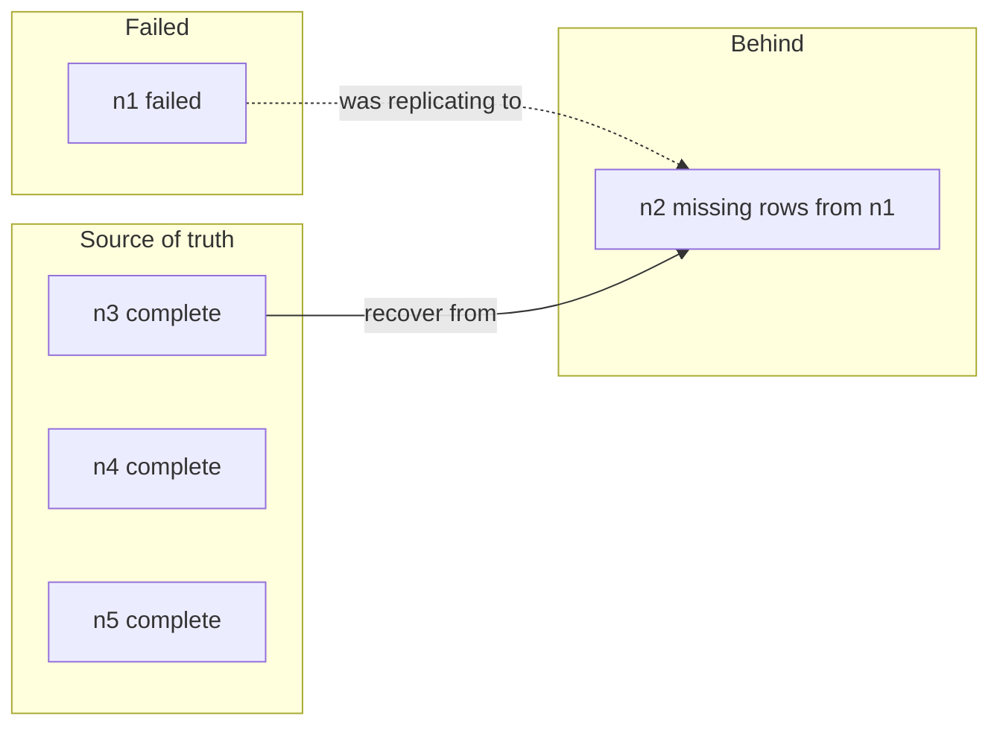
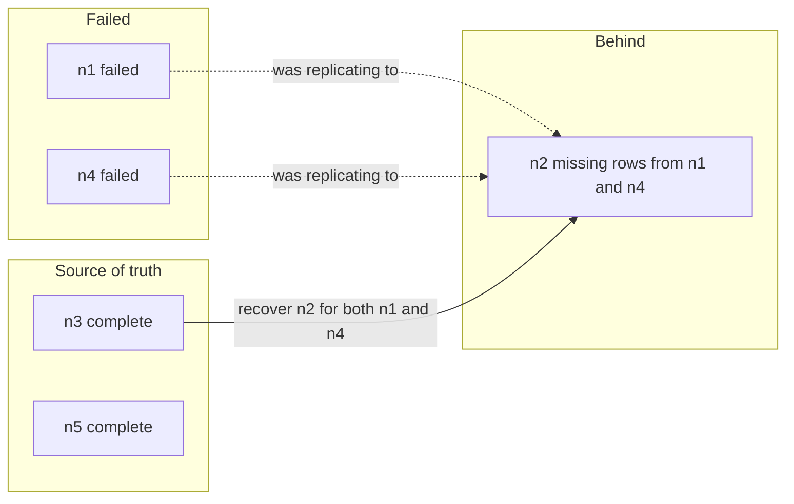
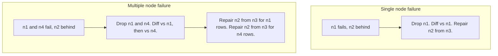
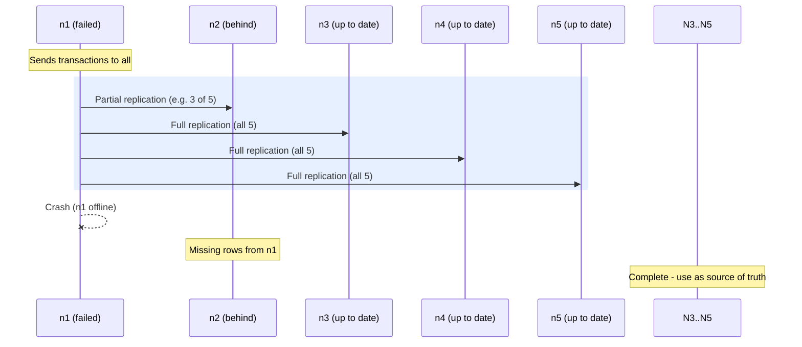
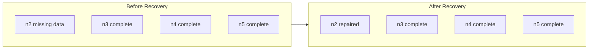

假设集群中有 n1、n2、n3、n4、n5 五个节点，经 Spock 逻辑复制互联。n1 向其余四个节点发送事务。由于网络延迟等原因，n3、n4 和 n5 已应用的某些事务还没到达 n2，n1 就崩溃了。此时 n2 落后，又无法从 n1 取得缺失数据。这就是**灾难性节点故障**。

集群可能允许多个节点接受写入。下文还会演示两个节点发生故障、且第二个节点故障前也产生过事务的情形。

以下介绍如何用 Spock 和 [Active Consistency Engine（ACE）](https://github.com/pgEdge/ace) 恢复节点。每个场景都选择一个已完全同步的节点作为数据基准。ACE 可补齐缺失数据，并保留各修复行的来源 ID 和提交时间戳，使复制元数据保持正确，避免由修复操作引入冲突。

本文讨论两种情况。

- **单节点故障**：一个节点故障，另一个节点进度落后。
- **多节点故障**：至少两个节点故障，一个或多个幸存节点进度落后。

两种情况的原理相同。先找出幸存节点缺少的数据，再以数据完整的节点为基准修复，保留各修复行的来源 ID 和时间戳。


## 单节点与多节点故障 {#single-node-failure-vs-multiple-node-failure}

以下图示分别说明两种情况及恢复方法。

### 场景一：一个节点故障，另一个节点落后 {#scenario-1-one-node-has-failed-and-one-node-is-lagging}

在第一个示例中，n1 故障时，n2 尚未收到它的全部事务。其余幸存节点 n3、n4、n5 的数据完整。



**执行恢复**

* n1 已故障。
* n2 进度落后。

数据基准应选 n3、n4 或 n5。

先清理复制配置。通过 Spock 命令删除与 n1 相关的订阅，再从集群中移除 n1。

然后在幸存的 n2 上对每张表执行：

  `table-diff --preserve-origin n1 --until <n1_failure_time>`

在 n2 上对每张有差异的表运行 ACE `table-repair`，并指定 `--recovery-mode`、`--source-of-truth n3` 和 `--preserve-origin`。

这样可以让 n2 补齐所有源自 n1 的行。

> **说明**：这里只概述流程。具体命令和选项从[阶段一：评估故障影响](#phase-1-assess-the-damage) 开始说明。首次修复后某些表可能仍有差异，处理方法见[故障排查](#troubleshooting)。

### 场景二：多个节点故障，一个节点落后 {#scenario-2-multiple-nodes-have-failed-and-one-node-is-lagging}

假设 n1、n4 都已故障，n2 仍在运行但进度落后，可能同时缺少源自 n1 和 n4 的数据。请选择一个完全同步的幸存节点作为统一的数据基准（此处选 n3），补齐 n2 缺少的**两个来源**的数据。

假定 n4 故障前也接受写入，因此集群中部分行的来源 ID 为 n4。



**执行恢复**

* n1 和 n4 已故障。
* n2 进度落后。

数据基准应选 n3 或 n5。

先删除与 n1、n4 相关的订阅，再从集群中移除这两个节点。

然后在幸存节点上，对每张表按故障来源分别运行 `table-diff`，指定 `--preserve-origin`，并用相应的 `failure_time` 限定截止时间。

  `table-diff --preserve-origin n1 --until <n1_failure_time>`；`table-diff --preserve-origin n4 --until <n4_failure_time>`

每次运行会为相应的「表、来源」组合生成一个差异文件。

随后在 n2 上，对每张有差异的表运行 `table-repair`，并指定 `--recovery-mode`、`--source-of-truth n3` 和 `--preserve-origin`。

这样可以补齐 n2 缺少的、来自 n1 和 n4 的全部行，同时保留每行的来源 ID 和时间戳。


> [!NOTE]
>
> 多节点故障时，对每个故障来源各执行一次比较与修复。因此每张表对 n1 执行一组，再对 n4 执行一组，所有修复都使用同一基准节点 n3。
>

### 两种故障的共同修复步骤 {#implementing-repairs-in-both-cases}



两种情况下都需执行以下步骤。

1. 清理 Spock 中与故障节点有关的配置。
2. 对全部复制表运行 table-diff。若有多个故障来源，则逐来源运行。
3. 以单一基准节点运行 table-repair，并加上 `--preserve-origin`，保留每个修复行的来源 ID 和提交时间戳。

---

## 单节点发生灾难性故障时的状态 {#what-happens-in-a-catastrophic-node-failure-of-a-single-node}

某节点在复制期间发生故障时，不同订阅方可能已应用它的不同批次事务。以单节点故障为例：

- **n1** 已故障且无法访问。
- **n2** 从 n1 收到的事务较少（如因网络延迟），进度落后。
- **n3、n4 和 n5** 收到了 n1 的全部事务，已完成同步。

现在需要让 n2 与 n3、n4、n5 一致。ACE 比较幸存节点上的表，只考虑来自 n1、且在故障前提交的数据，然后以选定节点（此处为 n3）为基准修复 n2。启用 `--preserve-origin` 后，ACE 为每个修复行保留**来源 ID**（最初写入该行的节点）和精确到微秒的**提交时间戳**。

下图展示 n1 故障时各节点的状态。



## 开始之前 {#before-you-begin}

恢复前先准备以下条件。

- **安装并配置 ACE**，运行 ACE 的主机须能访问幸存节点。ACE 用于跨节点比较和修复表数据。构建、安装及配置方法见 [ACE 仓库](https://github.com/pgEdge/ace) 和[文档](https://github.com/pgEdge/ace/tree/main/docs)（包括[配置说明](https://github.com/pgEdge/ace/blob/main/docs/configuration.md)）。
- **能够访问幸存节点** n2、n3、n4、n5。需要运行 ACE 命令，并使用 PostgreSQL 客户端连接各节点清理 Spock 配置。
- **掌握各节点大致的故障时间**，用它作为 ACE 比较的截止时间，只考虑故障前提交的数据。
- **开启来源跟踪**。Spock 集群的 PostgreSQL 配置应设置 `track_commit_timestamp = on`，使 ACE 可以利用并保留提交时间戳和来源 ID。


> [!NOTE]
>
> 请依次完成恢复和验证，确认所有表一致后再恢复日常流量。阶段四的每条 table-repair 命令都要加 `--preserve-origin`，才能保留修复行的来源 ID 和提交时间戳。比较或修复期间若仍有写入，首次修复后可能还有差异。常见原因及处理方法见[故障排查](#troubleshooting)。
>

## 恢复流程概览 {#overview-of-the-recovery-workflow}

恢复分为五个阶段，按以下顺序执行。

1. **评估影响**：检查复制状态，确认哪些节点落后、哪些已完全同步。

2. **清理 Spock**：删除与故障节点相关的订阅和复制槽，并从集群移除该节点。

3. **找出所有缺失数据**：对**每张**复制表运行 ACE table-diff，确定哪些表有差异，以及 n2 缺少哪些行。

4. **修复受影响的表**：对每张有差异的表运行 ACE table-repair，以 n3 或选定节点为基准。使用 `--preserve-origin` 保留各修复行的来源 ID 和提交时间戳。

5. **验证**：对所有已修复表再次执行 table-diff，确认 n2 与其他幸存节点一致。

n2 可能不只一张表缺数据，因此务必检查**全部**复制表。各阶段的具体命令如下。

---

## 阶段一：评估故障影响 {#phase-1-assess-the-damage}

连接各幸存节点，确认哪些节点落后、哪些持有完整数据。先用 [`spock.sub_show_status()`](/zh/pgedge/spock/reference/functions/spock-sub-show-status/) 查看订阅状态，再结合延迟判断。

例如，在 n2 上运行：

```sql
SELECT * FROM spock.sub_show_status();
```

查看每项订阅的当前状态及延迟。若延迟较大，或应为 `replicating` 的订阅显示 `down` 或 `initializing`，应进一步检查该节点的进度。示例如下。

```
 subscription_name | status      | provider_node | replication_sets
-------------------+-------------+---------------+---------------------------------------
 sub_n2_n1         | down        | n1            | {default,default_insert_only,ddl_sql}
 sub_n2_n3         | replicating | n3            | {default,default_insert_only,ddl_sql}
```

结果中 `sub_n2_n1` 为 `down`，表明 n2 与故障节点 n1 的连接已断。到 n3、n4、n5 的订阅仍正常。要衡量 n2 的落后程度，可用 [`spock.lag_tracker`](/zh/pgedge/spock/monitoring/lag-tracking/) 查看字节延迟和时间延迟。

确认各故障节点的大致故障时间，阶段三和阶段四的 ACE 命令会用到。优先查日志或监控；若没有记录，可取故障前最后一次确认正常的时间。

---

## 阶段二：清理 Spock {#phase-2-spock-cleanup}

确认 n1 已故障，且本次恢复不会把它重新投入运行后，才从集群中移除它，让其他节点停止等待与 n1 的双向复制。

在每个幸存节点（n2、n3、n4、n5）上执行以下检查和清理。

1. **删除与故障节点有关的订阅。**

   若订阅从 n1 接收或向 n1 发送数据，使用 [`spock.sub_drop()`](/zh/pgedge/spock/reference/functions/spock-sub-drop/) 删除。例如，在 n2 删除连接 n1 的订阅。

2. **从集群移除故障节点。**

   在一个幸存节点调用 [`spock.node_drop()`](/zh/pgedge/spock/reference/functions/spock-node-drop/) 移除 n1。这会删除 Spock 目录中的节点条目。


> [!WARNING]
>
> 删除订阅和节点不可撤销。执行前务必核实节点身份，并确认无须将原 n1 重新接入。
>

清理后剩下 n2、n3、n4、n5 四个节点。接下来使用 ACE 修复 n2 上的数据。

若有**两个或更多**节点故障（例如 n1 和 n4），对每个故障节点重复清理。
    
---

## 阶段三：找出全部缺失数据 {#phase-3-identify-all-of-the-missing-data}

先确定**哪些表**有差异，以及**缺少哪些数据**。ACE 的 [`table-diff`](https://github.com/pgEdge/ace/tree/main/docs/commands/diff) 可以跨节点比较表。指定 `--preserve-origin n1` 和 `--until <timestamp>` 后，比较范围限于源自 n1、提交时间不晚于指定时间的行，正好对应此故障场景。

必须对集群中的**每张**复制表运行 `table-diff`。只检查一张表，可能让其他表继续处于不一致状态。

### 第一步：列出所有待检查表 {#step-1-get-a-list-of-all-tables-to-check}

可从 `spock.tables` 取得参与复制的表。该视图列出各表及其所属复制集（如有）。在任一幸存节点（如 n3）执行：

```sql
SELECT nspname, relname, set_name
  FROM spock.tables
 WHERE set_name IS NOT NULL
 ORDER BY set_name, nspname, relname;
```

也可以列出被复制模式中的全部表。

```sql
SELECT schemaname, tablename FROM pg_tables WHERE schemaname = 'public'
ORDER BY tablename;
```

下一步按此清单逐表检查。下例使用 `customers`、`orders` 和 `products`，请换成实际的模式名及表名。

### 第二步：对每张表执行 table-diff {#step-2-run-table-diff-on-every-table}

对清单中的**每张**表运行 ACE table-diff，以故障节点为来源，用故障时间作为截止值。将 `2026-02-11T14:30:00Z` 替换为 n1 的实际故障时间，`mycluster` 替换为 ACE 集群名称。

检查单张表（例如 `public.customers`）时，可运行：

```bash
./ace table-diff \
  --nodes n2,n3,n4,n5 \
  --preserve-origin n1 \
  --until 2026-02-11T14:30:00Z \
  --output json \
  mycluster public.customers
```

各选项的作用如下。

- `--nodes n2,n3,n4,n5`：只比较幸存节点，包括待修复的 n2 和具有完整数据的节点。
- `--preserve-origin n1`：仅考虑来源 ID 为 n1 的行，以免混入幸存节点后续的本地写入。
- `--until 2026-02-11T14:30:00Z`：只考虑在该时间点或更早提交的行，使用 RFC3339 格式。
- `--output json`：将差异报告写为供修复使用的 JSON 文件。

ACE 返回的差异文件名含模式名和表名，例如 `public_customers_diffs-20260211143000.json`。对其他每张表重复执行，示例如下。

```bash
./ace table-diff \
  --nodes n2,n3,n4,n5 \
  --preserve-origin n1 \
  --until 2026-02-11T14:30:00Z \
  --output json \
  mycluster public.orders

./ace table-diff \
  --nodes n2,n3,n4,n5 \
  --preserve-origin n1 \
  --until 2026-02-11T14:30:00Z \
  --output json \
  mycluster public.products
```

### 第三步：审阅差异报告 {#step-3-review-the-diff-reports}

检查所有表的 table-diff 结果。对于**确有差异**的表，记下差异文件名，其中包含表名和时间戳。修复阶段将使用这些文件。没有差异的表无须修复。

如果 n1、n4 同时故障，幸存节点为 n2、n3、n5，则每张表要针对两个故障来源分别运行一次 table-diff，得到两份文件。

```bash
# Rows that originated from n1
./ace table-diff --nodes n2,n3,n5 --preserve-origin n1 \
  --until 2026-02-11T14:30:00Z --output json mycluster public.customers

# Rows that originated from n4 (use n4's failure time if different)
./ace table-diff --nodes n2,n3,n5 --preserve-origin n4 \
  --until 2026-02-11T14:35:00Z --output json mycluster public.customers
```

检查报告后，在阶段四使用同一基准节点（如 n3）分别对**每份**文件运行 table-repair。

表较多时可以编写循环。以下脚本遍历表名列表，请按实际模式调整列表。

```bash
FAILURE_UNTIL="2026-02-11T14:30:00Z"
CLUSTER="mycluster"
NODES="n2,n3,n4,n5"

for table in customers orders products invoices; do
  echo "Checking table: public.$table"
  ./ace table-diff \
    --nodes "$NODES" \
    --preserve-origin n1 \
    --until "$FAILURE_UNTIL" \
    --output json \
    "$CLUSTER" public."$table"
done
```

---

## 阶段四：修复所有受影响的表 {#phase-4-repair-all-affected-tables}

对阶段三发现有差异的*每张*表，使用对应文件运行 ACE `table-repair`。须启用恢复模式并指定 `--preserve-origin`，保留原始 `origin ID` 和 `commit timestamp`。省略 `--preserve-origin` 会使修复行获得 n2 的来源 ID 和新的提交时间，可能造成复制冲突或错误排序。使用 `--preserve-origin`，ACE 会沿用基准节点上每一行的来源 ID 和提交时间戳。

选择一个节点作为修复基准。本例中 n3、n4、n5 都有完整数据，选用 n3。可以让 ACE 自动选择对 n1 的来源 LSN 最高的幸存节点，也可通过 `--source-of-truth n3` 显式指定。

### 逐表修复命令 {#repair-command-for-each-table}

对每张有差异的表运行下列命令，将表名和差异文件名替换为本次 `table-diff` 的实际结果。

```bash
./ace table-repair \
  --diff-file=public_customers_diffs-20260211143000.json \
  --nodes n2,n3,n4,n5 \
  --recovery-mode \
  --source-of-truth n3 \
  --preserve-origin \
  mycluster public.customers
```

- `--diff-file`：由 table-diff 针对该表生成的 JSON 文件。
- `--nodes n2,n3,n4,n5`：参与操作的幸存节点，此处修复 n2，以 n3 为基准。
- `--recovery-mode`：差异文件生成时若用了 `--preserve-origin`，此选项必需，用于告知 ACE 这是灾难性故障恢复。
- `--source-of-truth n3`：使用 n3 的副本修复 n2。若省略，ACE 将选择对 n1 的 LSN 最高的幸存节点；若最高值相同或缺失 LSN，必须显式指定。
- `--preserve-origin`：保留修复行的来源 ID 和微秒精度的提交时间戳。修复后，n2 上每行的复制元数据都与基准节点一致。

对每张有差异的表重复操作，例如：

```bash
./ace table-repair \
  --diff-file=public_orders_diffs-20260211143000.json \
  --nodes n2,n3,n4,n5 \
  --recovery-mode \
  --source-of-truth n3 \
  --preserve-origin \
  mycluster public.orders

./ace table-repair \
  --diff-file=public_products_diffs-20260211143000.json \
  --nodes n2,n3,n4,n5 \
  --recovery-mode \
  --source-of-truth n3 \
  --preserve-origin \
  mycluster public.products
```

**多节点故障**（如 n1 和 n4）：每个「表、故障来源」组合各有一份差异文件。对**每份**文件运行 table-repair，始终使用**同一**基准节点 n3 和 `--preserve-origin`。每次 table-diff 会生成新文件；第一次修复使用比较 n1 来源时的文件，第二次使用比较 n4 来源时的文件。以下以一张表为例。

```bash
# Repair n2 for rows from n1
./ace table-repair \
  --diff-file=public_customers_diffs-20260211143000.json \
  --nodes n2,n3,n5 --recovery-mode --source-of-truth n3 \
  --preserve-origin mycluster public.customers

# Repair n2 for rows from n4 (different diff file from --preserve-origin n4)
./ace table-repair \
  --diff-file=public_customers_diffs-20260211143500.json \
  --nodes n2,n3,n5 --recovery-mode --source-of-truth n3 \
  --preserve-origin mycluster public.customers
```

两条命令都以 n3 为基准，保留修复行的来源 ID 和提交时间戳。


> [!WARNING]
>
> 灾难性故障修复应始终指定 `--preserve-origin`，以保留每一行的**来源 ID** 和**提交时间戳**。省略后将写入 n2 自己的来源 ID 及新的时间戳，可能导致复制冲突，或让冲突处理得出错误结果。
>

关于恢复模式及来源 ID 和时间戳的保留机制，参见 [ACE 仓库](https://github.com/pgEdge/ace)、[使用 ACE 恢复灾难性节点故障](https://github.com/pgEdge/ace/blob/main/docs/using-ace-for-cnf-recovery.md) 及 [table-repair 命令参考](https://github.com/pgEdge/ace/blob/main/docs/commands/repair/table-repair.md)。

---

## 阶段五：验证所有表一致 {#phase-5-validate-that-all-tables-match}

修复全部受影响的表后，确认 n2 与 n3、n4、n5 的数据一致。对每张已修复表再次运行 `table-diff`，**去掉** `--preserve-origin` 和 `--until`，使 ACE 比较各幸存节点上的完整表数据。

```bash
./ace table-diff --nodes n2,n3,n4,n5 --output json \
  mycluster public.customers
./ace table-diff --nodes n2,n3,n4,n5 --output json \
  mycluster public.orders
./ace table-diff --nodes n2,n3,n4,n5 --output json \
  mycluster public.products
```

若 ACE 报告各表一致，n2 即已恢复。重新启用或创建清理阶段移除而现在仍需的订阅，例如让 n2 再次订阅 n3、n4、n5 的新写入，然后恢复应用流量。如果修复期间其他节点仍有写入，最后再执行一次不带 `--preserve-origin` 和 `--until` 的全表比较，确认 n2 已彻底追平。

若仍有差异，审阅报告，检查比较期间是否有并发写入，必要时重新修复该表。常见原因和处理方法见[故障排查](#troubleshooting)。



---

## 为什么要保留来源 ID 和时间戳？ {#why-preserve-origin-id-and-timestamp}

ACE 写回 n2 的这些数据最早来自 n1。每行都有标识最初写入节点的**来源 ID**，以及记录提交时间的**提交时间戳**。Spock 依靠它们解决冲突、维持复制一致性。

如果修复时**省略** `--preserve-origin`，修复行将获得 n2 的来源 ID 和新的提交时间戳。可能产生以下后果。

- **复制冲突**：如果 n1 恢复，或新加入的节点保留了 n1 的历史，集群可能看到来源 ID 和时间戳不同的同一行，从而报告冲突。
- **顺序判断错误**：Spock 在「后写入者胜出」等冲突处理规则中使用提交时间戳与来源 ID，错误的元数据可能导致错误结果。
- **丢失数据来源记录**：无法再准确判断是哪一个节点产生了数据。

如果修复时**指定** `--preserve-origin`，ACE 会为每行保留原始来源 ID 和微秒精度的提交时间戳。n2 上的复制元数据便与基准节点一致，冲突处理和来源记录也能维持正确。

灾难性节点故障恢复时，每次运行 table-repair 都应使用 `--preserve-origin`。

---

## 使用 ACE 的注意事项 {#important-considerations-when-using-ace}

开始使用 ACE 恢复前，先检查以下事项。

### 涉及多张表的恢复 {#multi-table-recovery}

在节点间恢复多张表时，请注意以下几点。

- **检查每张表**：对所有复制表运行 table-diff，才能找全 n2 缺失的数据。
- **按需安排顺序**：表很多时，可以先修复关键表，但最终须比较全部表并修复每张受影响的表。
- **使用统一截止时间**：同一故障来源的所有表应使用相同的 `--until`，保持一致的故障边界。
- **统一数据基准**：对所有表使用同一基准节点（如 n3）最简单。若个别表确须用不同的基准节点，应记录原因与选择。

### 大表 {#large-tables}

对于大表，ACE 支持用 `--table-filter` 将比较限制在部分行，从而分块比较和修复。详见 [ACE table-diff 命令文档](https://github.com/pgEdge/ace/tree/main/docs/commands/diff)。

### 何时指定 --source-of-truth {#when-to-specify---source-of-truth}

若省略 `--source-of-truth`，ACE 会尝试选择对 n1 的来源 LSN 最高的幸存节点。若缺少 LSN 或最高值相同，ACE 会要求指定来源。请选择已知数据最完整的节点，本例中可以是 n3、n4 或 n5。

### 区分灾难性故障与网络分区 {#catastrophic-failure-vs-network-partition}

灾难性故障意味着节点已崩溃且无法恢复；网络分区时节点可能仍在运行，只是暂时无法访问。若只是分区，可以等待连接恢复，或按计划切换。只有确定该节点将永久退出此集群时，才应删除节点并执行本恢复流程。

---

## 故障排查 {#troubleshooting}

### ACE 提示缺少 LSN {#ace-says-lsn-information-is-missing}

显式指定 `--source-of-truth`，如 `--source-of-truth n3`，这样 ACE 无须探测 LSN 来选择来源。

### 多个节点落后 {#more-than-one-node-is-behind}

在 `--nodes` 中列出所有可能落后的节点，运行 `diff` 和 `repair`。选择数据完整的节点为基准，修复其余节点。

### 自动选择基准失败或出现并列 {#auto-source-of-truth-selection-fails-or-ties}

用 `--source-of-truth <node_name>` 指定一个已知数据完整的节点。

### 部分行缺少来源元数据 {#origin-metadata-missing-for-some-rows}

ACE 可能记录警告，并在无法保留来源 ID 和时间戳的情况下修复这些行。确认已设置 `track_commit_timestamp = on`，比较时使用了 `--preserve-origin`，并检查差异文件与 ACE 日志。

### 修复后表仍有差异 {#tables-still-differ-after-repair}

去掉 `--preserve-origin` 再次运行 `table-diff`，查看当前状态。若修复期间仍有写入，应重新比较，必要时再修复。大表可以使用 `--table-filter` 分块修复。

### 修复期间基准节点发生故障 {#source-node-fails-mid-replay}

若选定的基准节点（如 n3）在 ACE 修复期间故障或变得不可达，请立即停止，改用另一台完全同步的幸存节点后再继续。

1. 在各幸存节点再运行 `spock.sub_show_status()` 并检查延迟，确认哪些节点仍有完整数据。
2. 选定新的基准（如 n4 或 n5）。对所有尚未修复完的表重新运行 `table-repair`，并指定 `--source-of-truth n4`（若选择 n4）。


> [!WARNING]
>
> 如果集群只有三个节点，而基准节点又在修复时故障，可能不再有完整副本。此时无法保证修复完整且无冲突，可能丢失数据。可通过保留额外的温备节点，或在开始恢复前暂停应用写入来降低风险。
>

### 恢复无法完成（Spock 之外的故障） {#recovery-fails-entirely-non-spock-failure}

若落后节点在修复期间发生硬件或操作系统故障，可能需要从头重建。应移除损坏的节点，再用 ZODAN 节点管理过程添加替代节点。

- **移除损坏节点**：在幸存节点上删除相关订阅，使用 [`spock.node_drop()`](/zh/pgedge/spock/reference/functions/spock-node-drop/) 清理集群中的节点登记。
- **加入替代节点**：用 ZODAN 的 `add_node` 过程将新节点加入集群。ZODAN 会自动建槽、执行初始同步并建立订阅。步骤见 [ZODAN 文档](/zh/pgedge/spock/modify/zodan/) 和[教程](/zh/pgedge/spock/modify/zodan/zodan-tutorial/)。

---

## 恢复后的验证清单 {#post-recovery-validation-checklist}

全部修复操作完成后，先逐项核查，再恢复正常生产流量。

### 复制状态 {#replication-status}

- [ ] 在每个节点上运行 `SELECT * FROM spock.sub_show_status();`，确认所有订阅均为 `replicating` 且延迟为零或接近零。
- [ ] 确认阶段二清理时移除、恢复后仍需的订阅均已重新创建并启用。
- [ ] 在所有幸存节点运行 `SELECT * FROM spock.node;`，确认能看到已恢复的 n2，且其 DSN 正确。

### 清理复制槽 {#replication-slot-cleanup}

- [ ] 在各节点运行 `SELECT slot_name, active, restart_lsn FROM pg_replication_slots;`，确认没有故障节点或恢复过程遗留的陈旧或闲置槽。
- [ ] 若仍有孤立的槽，例如原属 n1 而未删除的槽，在持有它的节点上用 `SELECT pg_drop_replication_slot('<slot_name>');` 删除。

### 数据完整性 {#data-integrity-check}

- [ ] 对所有修复的表重新运行 `table-diff`，**去掉** `--preserve-origin` 和 `--until`，确认各节点的完整表内容相同。

    ```bash
    ./ace table-diff --nodes n2,n3,n4,n5 --output json \
      mycluster public.<table_name>
    ```

- [ ] 确认 ACE 报告每一张表均无差异。
- [ ] 对于关键表，可抽查恢复节点与已知正常节点的行数。

    ```sql
    SELECT COUNT(*) FROM public.customers;
    ```

- [ ] 若 `track_commit_timestamp = on`，使用 `pg_xact_commit_timestamp()` 和 `spock.xact_commit_timestamp_origin()` 核实修复行的来源 ID 和提交时间戳与基准节点一致。

### 最终确认 {#final-sign-off}

- [ ] 重新开放应用流量后，至少持续观察复制延迟 15–30 分钟，确认恢复节点能够跟上负载。
- [ ] 查看恢复节点的 PostgreSQL 日志，检查是否有复制错误或警告。
- [ ] 记录受影响的节点、`--until` 使用的故障时间、所选基准节点，以及哪些表需要多次修复。

---

## 小结 {#summary}

恢复落后或受损节点的步骤主要取决于需要修复或重建的节点数。

单节点故障时：

1. **评估影响**：找出落后节点并确定故障时间。
2. **清理 Spock**：删除到故障节点的订阅，再从集群中移除该节点。
3. **找出缺失数据**：对所有复制表运行 ACE table-diff，指定 `--preserve-origin node_name` 和 `--until <failure_time>`。
4. **修复受影响的表**：运行 ACE table-repair 并使用以下选项。

    - `--recovery-mode`
    - `--source-of-truth n3`
    - `--preserve-origin`（用于保留复制元数据）

5. **验证恢复结果**：重新运行 table-diff，确认幸存节点之间的每张表均一致。

多节点故障的操作相似，区别如下。

1. **评估影响**：确认落后节点，并分别确定每个故障节点的故障时间。
2. **清理 Spock**：删除与所有故障节点相关的订阅，再将故障节点逐一移出集群。
3. **找出缺失数据**：每张表按故障来源分别运行 table-diff。

    - `--preserve-origin n1` 配合 n1 的故障时间。
    - `--preserve-origin n4` 配合 n4 的故障时间。

4. **修复受影响的表**：对生成的**每份**差异文件执行 table-repair。

   - 所有修复均使用同一 `--source-of-truth`（例如 n3）。
   - 每次都指定 `--preserve-origin`。

5. **验证恢复结果**：重新运行 table-diff，确认各节点的表一致。

### 保留修复行的来源信息 {#critical-reminder}

两种情况下都要使用 `--preserve-origin`，以保留每一行的来源 ID 和提交时间戳。检查全部复制表，确认落后节点已完整恢复。


## 另请参阅 {#see-also}

- [GitHub 上的 ACE（Active Consistency Engine）](https://github.com/pgEdge/ace)：构建、安装、配置 ACE，查阅命令参考和架构文档。
- [ACE 文档](https://github.com/pgEdge/ace/tree/main/docs)：包括配置、灾难性节点故障恢复及命令参考（如 `table-diff`、`table-repair`）。

---

[上游原文](https://github.com/pgEdge/spock/blob/d05e2e2b6a82796d86e3c16ffb0d3fc38b1b329c/docs/recovery/catastrophic_node_failure.md) · `d05e2e2b6a82` · Copyright (c) 2021–2026, pgEdge, Inc.; portions Copyright the PostgreSQL Global Development Group and The Regents of the University of California. [PostgreSQL 许可证](/zh/pgedge/about/license/)。
